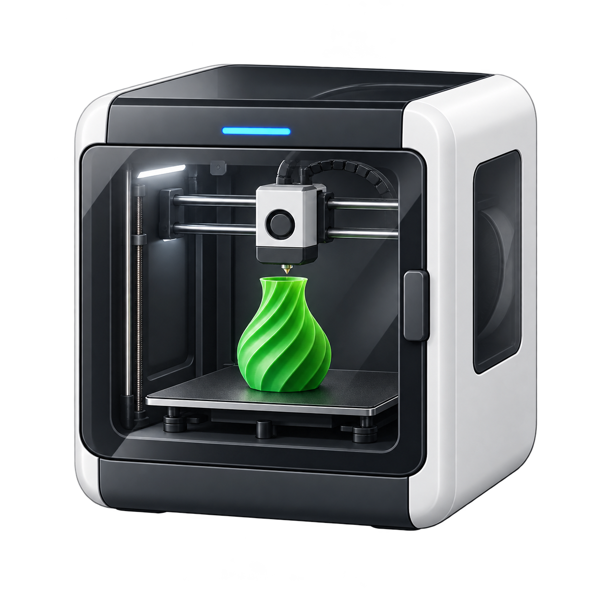
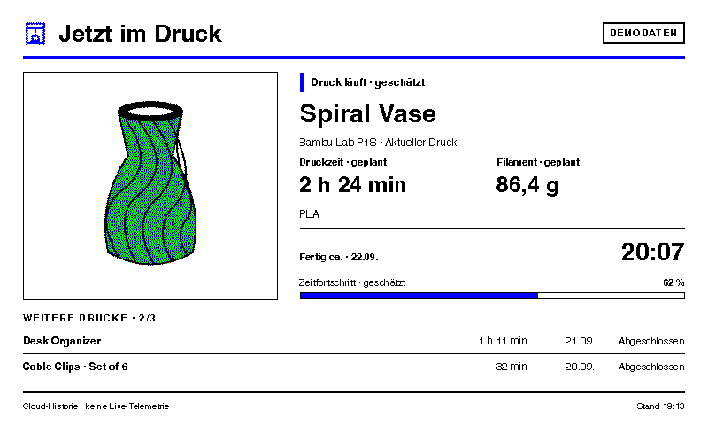
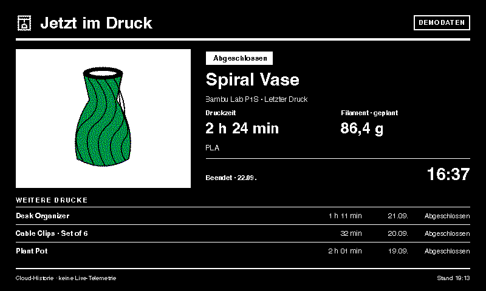
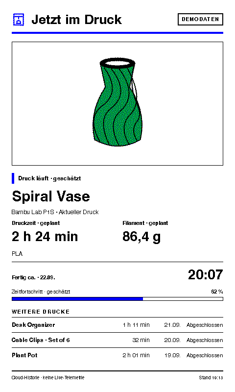
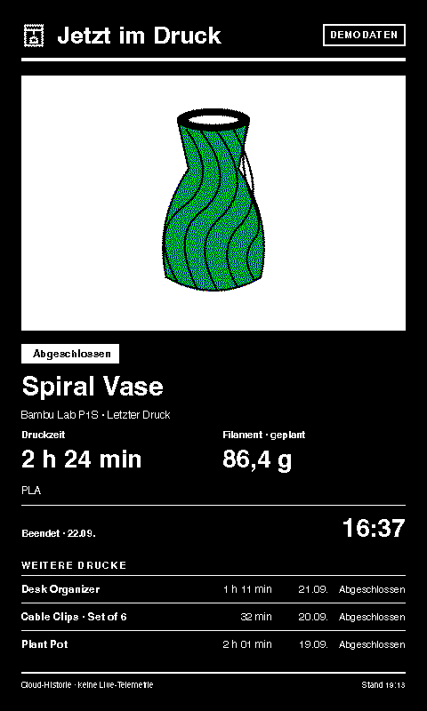

# Bambu Lab · Now Printing



Shows a Bambu Lab cloud print with its model image, estimated finish time, planned filament weight and material, plus up to four recent prints (oldest rows are omitted when the display needs more space, with a visible count). With no current print, the latest job remains on screen. German and English, portrait and landscape, with global light/dark color themes.

- [Manifest](./config.json) · [Production install URL](https://integrations.paperlesspaper.de/bambu-lab/config.json) (available after deployment)
- [Local preview](http://localhost:3000/bambu-lab/run) after `npm start` · [Einrichtung auf Deutsch](#einrichtung-auf-deutsch)
- Inspiration: [Now Printing (Cloud)](https://trmnl.com/recipes/478721), shared in [this Reddit post](https://www.reddit.com/r/trmnl/comments/1wn8p5w/now_printing_is_a_public_now_your_bambu_lab/).

## Connect your printer

1. Sign in to [MakerWorld](https://makerworld.com) with your Bambu account. In browser developer tools, open **Application** (Chrome) or **Storage** (Firefox), then **Cookies → makerworld.com**, and copy the value of `token`.
2. Paste it into **Bambu Lab access token**. Select your account region: Global or China.
3. Optionally enter the printer serial number from Bambu Handy / device information to filter one printer. With no filter, the account's latest active print is featured and other recent jobs can belong to different printers.
4. Turn **Use labelled demo data** off. The default preview deliberately uses labelled sample prints. Demo state only affects demo mode.

Replace the token when it expires or access is denied. The integration does not collect your account password or perform token refresh. No local bridge or MQTT connection is required.

## Einrichtung auf Deutsch

1. Mit dem Bambu-Konto bei [MakerWorld](https://makerworld.com) anmelden. In den Browser-Entwicklertools **Application / Anwendung** (Chrome) oder **Storage / Speicher** (Firefox) öffnen. Unter **Cookies → makerworld.com** den Wert von `token` kopieren.
2. In der Integration **Bambu Lab access token** ausfüllen und die Kontoregion wählen: `global` oder `china`.
3. Optional die Drucker-Seriennummer aus den Geräteinformationen in Bambu Handy eintragen. Ohne Filter werden die neuesten Drucke des Kontos berücksichtigt.
4. **Use labelled demo data** ausschalten. Solange der Demomodus aktiv ist, zeigt die Integration ausdrücklich markierte Beispieldaten.

Bei abgelaufenem Token den Wert erneut aus MakerWorld übernehmen. Es wird kein Bambu-Passwort benötigt. Die Anzeige verwendet die Cloud-Historie: Fortschritt und Fertigstellungszeit sind Schätzungen, SD-Karten- und reine LAN-Drucke können fehlen. Die Aktualisierung steuert der paperlesspaper-Host.

## Settings reference

| Setting | Default | Purpose |
| --- | --- | --- |
| `color` | `blue-light` | Global display theme; selected by the host. |
| `title` | Empty | Optional title; otherwise localized “Jetzt im Druck” / “Now Printing”. |
| `sampleData` | `true` | Explicitly labelled demo. Turn off to read your account. |
| `demoState` | `printing` | Demo scenario: `printing`, `finished`, `failed` or `empty`. |
| `token` | Empty | Bambu access token, entered in a password field. |
| `region` | `global` | `global` or `china`, matching the Bambu account. |
| `deviceId` | Empty | Optional printer serial number; empty includes all printers. |
| `historyLimit` | `3` | Number of additional jobs, 0–4. Oldest rows can be omitted to fit. |
| `showMaterial` | `true` | Show the current job's filament material when supplied. |
| `showHeader` | `true` | Show the title bar; the demo label remains visible when hidden. |

Interface language comes from the host. The display uses Europe/Berlin for dates and times.

## Troubleshooting

| Display / symptom | Action |
| --- | --- |
| Demo data remains visible | Disable `sampleData`; entering a token alone does not disable the demo. |
| Token expired / access denied | Replace the token and check the account region. |
| No cloud prints | Check the serial-number filter and whether the job was sent through Bambu Cloud. |
| “Status prüfen” / “Check status” | The time estimate elapsed without a confirmed final status. Check Bambu Handy; the integration does not infer success. |
| No model image | The job has no accessible supported CDN image, or loading failed. Other print data remains visible. |
| Cloud unavailable | Retry later; provider errors do not switch the display to demo data. |

## What the screen means

This reads the **unofficial** Bambu Cloud history endpoint `GET /v1/user-service/my/tasks`, which can change. It is not a real-time printer monitor. Cloud history may lag behind the device; SD-card/LAN-only prints may be absent. Refresh is driven by the display host; server results are cached for up to 60 seconds per account and printer filter.

- Print duration for completed/failed jobs is the actual difference between start and end timestamps when available.
- Planned duration (`costTime`) and weight (`weight`) are slice estimates for the whole job, including jobs aborted early. Filament material is read from `amsDetailMapping`, with `material.name` as a fallback.
- A nonterminal record with no end time or an end within one minute of its start is treated as potentially running. Time progress and finish time are explicitly marked as estimates. Once the estimate has elapsed, the screen asks to check status; elapsed time never implies successful completion.
- Cloud status `2` means finished; `3` means aborted or failed. Terminal states override the historic timestamp sentinel so short jobs are handled correctly. Unknown states remain labelled; temperatures, layer counts and real live progress are not invented.
- Up to 50 recent cloud jobs are requested. The most recently started active job takes priority, otherwise the latest job is shown. Empty histories have a dedicated screen. Failed requests never fall back to demo prints.
- Images use the provider's public HTTPS CDN. Missing, rejected, slow or broken images show an illustrated placeholder. Image requests do not carry the account token.
- Dates and times use Europe/Berlin, matching the manifest timezone.

The implementation's field semantics follow the observed responses documented by [OpenBambuAPI](https://github.com/Doridian/OpenBambuAPI/blob/main/cloud-http.md#get-v1user-servicemytasks). The region endpoints are also used by [bambulab-cloud](https://docs.rs/bambulab-cloud/latest/src/bambulab_cloud/lib.rs.html).

## Data handling

The renderer sends settings to the same-origin adapter in a JSON POST body. The server sends the token only as a Bearer header to the fixed Bambu endpoint. Requests have time and size limits; credentialed redirects are refused. Error screens do not echo upstream responses or credentials. Live tokens must not be put into query strings, screenshot variants or shared preview links.

Use a trusted HTTPS integration server: the renderer and server necessarily receive the token. Read-only requests do not make the account token itself read-only. Revoke exposed tokens. The demo vase is an original local vector illustration. The catalog icon is a generated transparent PNG; its prompt and provenance are recorded in [icon documentation](../../docs/integration-icon-prompts.md#bambu-lab).

## Validation

```sh
npm run check:bambu-lab
npm run screenshots -- --app bambu-lab
npx paperless render applications/bambu-lab/config.json --viewport 800x480 --color blue-light --output /tmp/bambu-lab.png
npx paperless dev applications/bambu-lab/config.json
```

The check command validates the manifest, runs adapter tests and checks 96 language/theme/state/viewport combinations plus image and error handling. It needs Chrome (`CHROME_BIN` overrides the macOS default) and a free local port (`BAMBU_TEST_PORT`, default 4359).

The screenshot command refreshes both variants at 800×480, 480×800, 1600×1200 and 1200×1600 with production-like EPD processing. Configured screenshots use explicit demo data. Live-account validation requires a user's token and has not been performed with repository fixtures.

| Printing · light | Latest print · dark |
| --- | --- |
|  |  |
|  |  |
