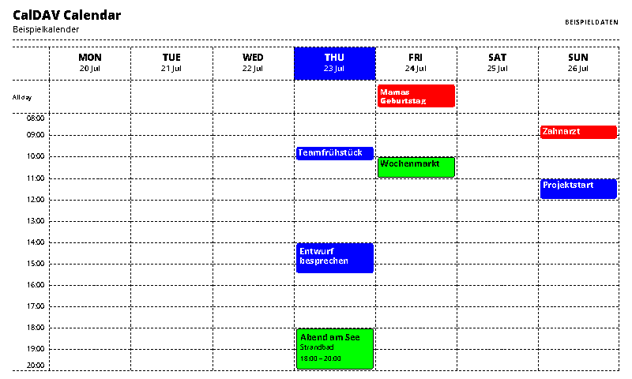
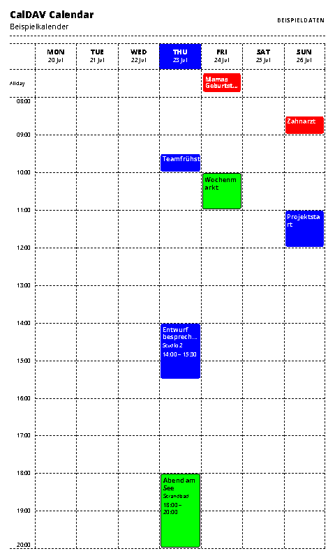
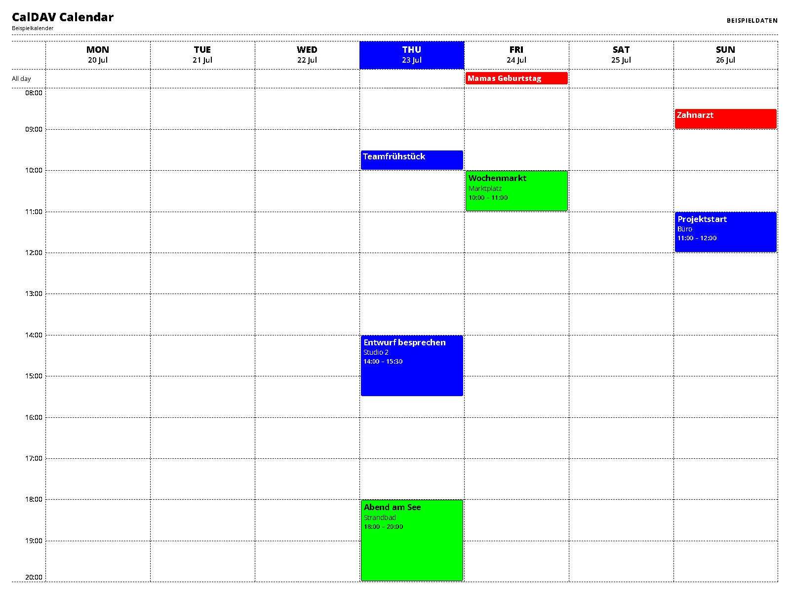
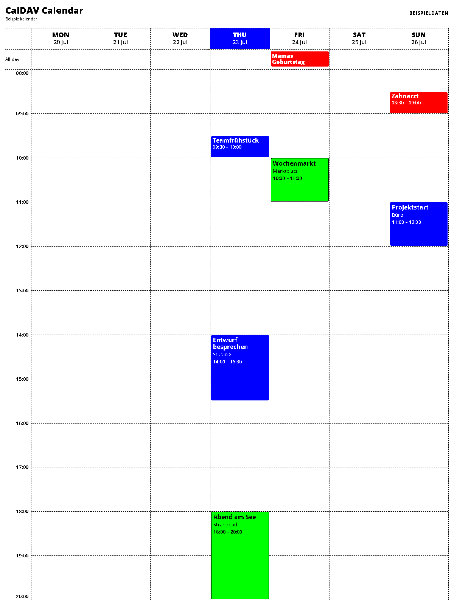

# CalDAV Calendar

Displays one calendar collection through read-only CalDAV requests. The adapter performs a
date-bounded `calendar-query` `REPORT`, extracts the returned iCalendar objects, expands bounded
recurrences, and hands canonical events to the shared paperlesspaper calendar layouts.

## Setup

The form is pre-filled with Digital Peak's public DPCalendar demo collection and its published
`demo` / `demo` account. This shared calendar is mutable, so its contents may change; use it only to
preview the integration, then replace all three connection fields with your own CalDAV details.

```text
Calendar URL: https://demo.digital-peak.com/dpc/components/com_dpcalendar/caldav.php/calendars/demo/dp-494/
Username:     demo
Password:     demo
```

1. Obtain the exact CalDAV collection URL for the calendar you want to display. It normally ends in
   the calendar's collection path and is not the provider's browser or account URL.
2. Replace the public demo username and password. Use a dedicated app password when the provider
   offers one.
3. Optionally set **Calendar label** for the display header.
4. Select the display timezone and preferred calendar view.

This initial generic adapter deliberately accepts an exact collection URL instead of performing
provider-specific account discovery. It supports HTTP Basic authentication and read-only event
queries. It does not support OAuth, Digest authentication, event writes, scheduling, or merging
multiple calendar collections. The dedicated Nextcloud integration remains the better choice when
Nextcloud principal and calendar-home discovery are wanted.

## Shared calendar settings

`view`, `locale`, `timeZone`, `dayRange`, `maxEvents`, `highlightToday`, `highlightScale`, and
`showLocation` are handled by `@paperlesspaper/openintegration`. Supported views are `agenda`, `agenda-modern`, `today-next`, `rolling-week-list`, `rolling-week`,
`day`, `three-days`, `week`, and `year`.

The `calendar-query` is limited to the visible civil range. Each returned RFC 5545 object is parsed
for date-only and timed events, timezone definitions, recurrence rules and dates, exclusions,
moved occurrences, cancellations, and multi-day events. `maxEvents` remains a display limit; the
adapter independently returns up to 500 bounded occurrences.

## Network and credential safety

The collection URL, username, and password are sent to the same-origin adapter in a JSON `POST`,
keeping them out of query strings and routine URL access logs. This is not a secret vault: the
trusted renderer and server receive them, and browser inspection or explicit body logging can
expose them. Use a trusted HTTPS deployment, disable request-body logging, prefer a revocable app
password, and grant read-only access where the provider allows it.

The adapter resolves and pins the destination before connecting, rejects redirects while
credentials are present, and blocks private, loopback, link-local, and non-routable destinations by
default. A trusted self-hosted deployment may opt into private networks with:

```sh
PAPERLESSPAPER_ALLOW_PRIVATE_CALENDAR_NETWORKS=true
```

Plain HTTP additionally requires both **Allow insecure HTTP** and:

```sh
PAPERLESSPAPER_ALLOW_INSECURE_CALENDAR_HTTP=true
```

Do not enable either override on an unrestricted public integration host. Requests have DNS,
timeout, response-size, occurrence, and date-range limits.

## Local verification

```sh
node vendor/openintegration/dist/cli.js check applications/caldav/config.json
node vendor/openintegration/dist/cli.js render applications/caldav/config.json --viewport 800x480 --output /tmp/caldav-landscape.png
node vendor/openintegration/dist/cli.js render applications/caldav/config.json --viewport 480x800 --output /tmp/caldav-portrait.png
```

## Specifications

- [RFC 4791: Calendaring Extensions to WebDAV](https://www.rfc-editor.org/rfc/rfc4791)
- [RFC 5545: Internet Calendaring and Scheduling Core Object Specification](https://www.rfc-editor.org/rfc/rfc5545)
- [DPCalendar CalDAV demo documentation](https://joomla.digital-peak.com/documentation/dpcalendar/introduction/calendar-management)

## Calendar design options

Choose **View & design** in the integration settings:

- **Agenda (classic)** (`agenda`): the original compact chronological list.
- **Agenda (modern)** (`agenda-modern`): larger dates, open spacing and small calendar-color markers.
- **Today & next** (`today-next`): today and upcoming days, with the next or ongoing appointment highlighted.
- **Next 7 days (list)** (`rolling-week-list`): today plus six days, arranged as day lists.
- **Next 7 days (time grid)** (`rolling-week`): the same rolling week with appointments positioned by time.

The designs adapt to portrait and landscape and respect the selected color theme.
Modern agenda and Today & next use `dayRange`. Both rolling views always show seven
local dates starting today; `maxEvents` applies per day. In portrait, the rolling
time grid splits into four plus three days with the same hour scale. When space is limited, an additional-event count indicates hidden
appointments. In **Today & next**, `maxEvents` applies separately to today and the
upcoming list. Existing saved view values and the default classic agenda are preserved.

<!-- calendar-screenshots:start -->
## Screenshots

Fresh renders with fictional events. Catalog PNGs are processed for the Spectra 6 palette.

[All ten views, icons, images and event concepts](../../docs/screenshots/calendars/README.md) · [Interactive gallery](../../docs/screenshots/calendars/index.html)

| Variant | 7.3″ landscape | 7.3″ portrait | 13″ landscape | 13″ portrait |
| --- | --- | --- | --- | --- |
| CalDAV Calendar · Calendar week | [](../../docs/screenshots/calendars/providers/caldav-week-1-blue-light-800x480-epd.png) | [](../../docs/screenshots/calendars/providers/caldav-week-1-blue-light-480x800-epd.png) | [](../../docs/screenshots/calendars/providers/caldav-week-1-blue-light-1600x1200-epd.png) | [](../../docs/screenshots/calendars/providers/caldav-week-1-blue-light-1200x1600-epd.png) |

<!-- calendar-screenshots:end -->

<!-- calendar-personal:start -->
## Personal calendar options

All seven calendar integrations share these independently configurable options:

| Setting | Default | Behavior |
| --- | --- | --- |
| `showDaySummary` | `false` | Remaining timed appointments (including ongoing ones), separate all-day count, next appointment and last known end today. Uses the selected timezone and shows the render/update time. |
| `automaticEventIcons` | `false` | Local German/English title rules suggest icons for birthdays, medical appointments, flights, school, shopping, calls, music, cinema, cycling, coffee and meetings. Unknown titles keep their plain appearance. |
| `showEventIcons` | `true` | Master switch for manual and automatic icons. Explicit `iconName` or `[icon:…]` takes priority over suggestions. |
| `showHeader` | `true` | Hide or show the entire provider/personal header, independently of the day summary. |
| `personalTitle` / `personalSubtitle` | empty | Override the existing heading/subtitle. Blank values retain provider defaults. Text only; maximum 100/160 characters. |
| `informationDensity` | `comfortable` | `comfortable` preserves the standard layout. `automatic` measures available space using shared `fitText`; `compact` reduces type and spacing, `spacious` enlarges them. The existing `fontSize` setting remains effective. |

Agenda, day columns, modern agenda, Today & next and rolling lists show `+ more` for whole appointments that cannot fit. Automatic modern and rolling lists grow/shrink text within a bounded range before hiding entries; classic views reuse their existing text fitting with counted overflow, while time grids retain proportional time geometry. Resizing recomputes fitting and restores entries when space becomes available. No locations or event images are silently disabled by the density setting.

The day summary uses all loaded events for today before the display's `maxEvents` limit. Ended events are excluded; an appointment without an end is counted until its start time. Missing end times, overnight appointments and all-day events suppress the last-end statement. The summary describes the loaded calendar data, not availability across other accounts; it updates when the host renders fresh data, with no per-minute display refresh.

Common icons are bundled SVG artwork and work offline. Other explicit Iconoir names use the integration's existing Iconoir stylesheet. Google accepts manual tokens in the title and description; iCalendar feeds preserve description tokens too. Outlook title tokens work without requesting extra description fields. Suggestions never rewrite source events or send titles to an external service.

Suggested setup: modern agenda or Today & next, `showDaySummary: true`, `automaticEventIcons: true`, `informationDensity: "automatic"`, and your own title. Extra features are opt-in so existing displays keep their presentation.

[Examples on 7.3-inch and 13-inch displays](../../docs/screenshots/calendars/README.md) · [Interactive gallery](../../docs/screenshots/calendars/index.html)
<!-- calendar-personal:end -->

## Minimal day timeline

Select **Day timeline (minimal)** (`view: "day-timeline"`) under **View & design**. The layout shows the current local day with a proportional time axis, native-color event rails, overlapping appointments in separate lanes and a large next-event time. In portrait, the next event and due list move below the timeline. Source calendar colors and the global light/dark theme remain active.

The visual reference is [Clean minimal calendar plugin by iUnstable0](https://www.reddit.com/r/trmnl/comments/1xhfqqt/clean_minimal_calendar_plugin/). This is an independent implementation in the shared paperlesspaper renderer; it does not use the reference project's code or server.

| Option | Default | Behavior |
| --- | --- | --- |
| `timelineShowSidebar` | `true` | Next appointment plus due/all-day list. When disabled, due/all-day entries remain above the time axis. |
| `timelineShowNow` | `true` | Red “Now” marker at render time, without a numeric clock label. It refreshes with the calendar, not continuously. |
| `timelineShowGaps` | `true` | Labels gaps between known timed commitments. All-day events, unknown end times and DST-crossing intervals suppress these labels. |
| `timelineGapMinutes` | `30` | Minimum labeled gap, configurable from 15 to 240 minutes. |

Mark a calendar event with `[todo]` in its title to put it in **Due today**. Its start/date is its due time. Google and iCalendar feeds also accept the marker in the event description. Host adapters may supply `kind: "task"` in the canonical event shape. These are read-only calendar deadlines, not a connection to Google Tasks, Microsoft To Do or iCalendar VTODO. Task deadlines do not stretch the timeline or count as occupied time. Explicitly non-busy events (`busy: false`, Google transparent events or iCalendar `TRANSP:TRANSPARENT`) do not bound free gaps.

The timeline uses the complete loaded day to establish its range and gaps even if `maxEvents` hides entries. Very short appointments retain a readable minimum height; overlapping visual blocks use lanes, and events that cannot fit in those lanes are counted in `+ more`. Location/time details are omitted from short blocks before titles are clipped. Full event time/title remain in accessible markup. The next-event panel prefers the next future appointment, then an ongoing appointment if no future one exists. Due entries are plain text rather than inactive checkboxes; ongoing appointments use only a colored rail, without an enclosing outline. Text line boxes reserve space for descenders before overflow fitting.

Existing personal heading, icon, image, font-size and information-density settings continue to apply. Choosing this view is optional and does not change the default calendar view.
