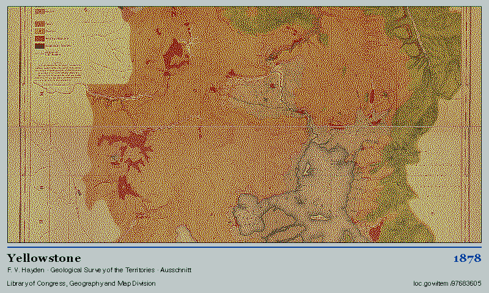

# Historical Maps · Historische Karten

A colour map archive for paperlesspaper, inspired by **[I Love Maps / trmnl-maps by thefinkus](https://github.com/thefinkus/trmnl-maps)**. Five bundled historical colour scans rotate daily, or a favourite can stay on screen. No account, API key or external request is needed while rendering.



## Settings

- **Map / Karte:** leave empty for daily rotation; select one of the five map IDs to pin it.
- **View / Ansicht:** `detail` fills the available area with a cropped view, explicitly labelled as a detail; `complete` displays the whole sheet without cropping or distortion.
- **Time zone / Zeitzone:** the IANA time zone used for the day's selection; defaults to `Europe/Berlin`. The same civil day always selects the same map, including daylight-saving transitions.
- **Day offset / Tagesversatz:** move the daily selection forward or backward by up to 3650 days. Does not affect a pinned map. The five-map cycle visits each map once before repeating.
- **Show description / Beschreibung anzeigen:** optionally enable the short contextual description (off by default). The archive heading, rotation counter and image badge have been removed. A compact caption retains title, date, creator, collection credit and item link; the inspiration is credited in this README. Cropped images are labelled in the creator line.
- **Global colour:** defaults to `blue-light`; all shared themes are supported. Themes change the reading surface and accents, preserving the original scan colours.

German and English copy follows the host language. Historical titles, dates, names and boundaries reflect the source maps. The cards are historical illustrations, not current navigation maps. Approximate publication dates remain marked with `c.`.

The renderer handles later INIT updates, cancels superseded image loads, waits for image decoding and fonts, and reports invalid map IDs, time zones and missing assets as visible errors. It renders only on host refresh; a daily refresh is sufficient for the daily rotation.

## References, provenance and rights

### Inspiration: thefinkus / I Love Maps

The presentation idea of rotating historical cartographic details comes from [thefinkus/trmnl-maps](https://github.com/thefinkus/trmnl-maps), the image host for the TRMNL plugin **I Love Maps**. This is an independent paperlesspaper implementation; no affiliation with or endorsement by thefinkus, TRMNL, Stanford Libraries or the Library of Congress is implied.

The reference repository's [README](https://github.com/thefinkus/trmnl-maps/blob/main/README.md) and [licence notice](https://github.com/thefinkus/trmnl-maps/blob/main/LICENSE.md) credit the **David Rumsey Map Collection, David Rumsey Map Center, Stanford Libraries**. Its grayscale crops are published under **[CC BY-NC-SA 3.0](https://creativecommons.org/licenses/by-nc-sa/3.0/)**; code and markup are described as MIT. The [Rumsey collection's permissions](https://www.davidrumsey.com/about) distinguish noncommercial use from commercial permission.

**No code, cropped image, or catalogue metadata from trmnl-maps is bundled here.** The original colour scans below were independently selected from the Library of Congress. Rumsey/Stanford is acknowledged as the source of the reference project's images, not as the source of these different scans. The reference project's CC licence is not applied to this integration or to the Library of Congress images.

### Bundled map scans

Credit line for every image: **Library of Congress, Geography and Map Division.** Each linked item record's Rights & Access section permits use and reuse unless an individual Rights Advisory says otherwise; no restrictive item-specific advisory was identified for these five records when checked on **2026-10-06**. This records the collection's statement rather than asserting that all material held by the institution is public domain.

| Map ID | Original title | Creator / publisher / printer | Date | Catalogue source |
| --- | --- | --- | --- | --- |
| `yellowstone-1878` | Preliminary geological map of the Yellowstone National Park | Geological and Geographical Survey of the Territories (U.S.); F. V. Hayden | 1878 | [LOC 97683605](https://www.loc.gov/item/97683605/) |
| `switzerland-1794` | A new map of Switzerland : divided into the thirteen cantons with their allies & their subjects | Robert Laurie and James Whittle, London | 1794 | [LOC 2009579456](https://www.loc.gov/item/2009579456/) |
| `east-asia-1873` | China (östl. Theil), Korea und Japan im Massstabe von 1:7.500.000 | August Petermann; Ernst Debes; Justus Perthes, Gotha | 1873 | [LOC 2006627863](https://www.loc.gov/item/2006627863/) |
| `paris-1878` | Nouveau Paris monumental : itinéraire pratique de l'étranger dans Paris | F. Dufour; Garnier frères; Dufrénoy, printer | c. 1878 | [LOC 2012586602](https://www.loc.gov/item/2012586602/) |
| `paris-environs-1878` | Paris et ses environs : 1878 | Ed. Dumas-Vorzet; Institut géographique de Paris; Becquet frères, printer | 1878 | [LOC 2012586603](https://www.loc.gov/item/2012586603/) |

Yellowstone is downloaded from the Library's IIIF image service. The other four Library scans are downloaded from their **Wikimedia Commons mirrors**, which identify the originals and mark the reproductions public domain. Exact per-image mirror pages, download URLs, original contributors, rights links, retrieval date and SHA-256 checksums are recorded in [data/maps.json](data/maps.json). The metadata distinguishes original collection credit from the file delivery service.

**Changes to the images:** reduced-resolution JPEG delivery, optional viewport cropping, and the display's Spectra 6 colour approximation with error-diffusion dithering. No artificial colourisation, invented cartographic detail or image generation. Descriptions and shortened display titles are independently written in German and English. Full original titles are retained in the catalogue and image alt text.

The original code-drawn folded-map icon is included as SVG source and a transparent 1024 × 1024 PNG. It does not reuse the reference project's branding.

## Validation and previews

From the repository root:

```sh
npx paperless check applications/historical-maps/config.json
node --test tests/historical-maps.test.mjs
node scripts/check-historical-maps.mjs
npx paperless dev applications/historical-maps/config.json
npx paperless render applications/historical-maps/config.json --viewport 800x480 --settings '{"mapId":"yellowstone-1878","color":"blue-light"}' --output /tmp/historical-maps-epd.png
```

The browser check covers every map in German and English at 800×480, 480×800, 1600×1200 and 1200×1600; both views in blue-light, green-dark and dark; hidden optional text; source visibility; overflow; repeated INIT messages; and error states. Raw QA images go into `output/historical-maps/`. The checked-in `screenshots/` images declared in `configVariants` are production-like processed Spectra 6 output, not raw browser captures.

The installed validator currently warns that the global `color` setting has no form field. The canonical integration contract explicitly excludes `color` from `formSchema`, so this warning is expected. No shared runtime change is required.
