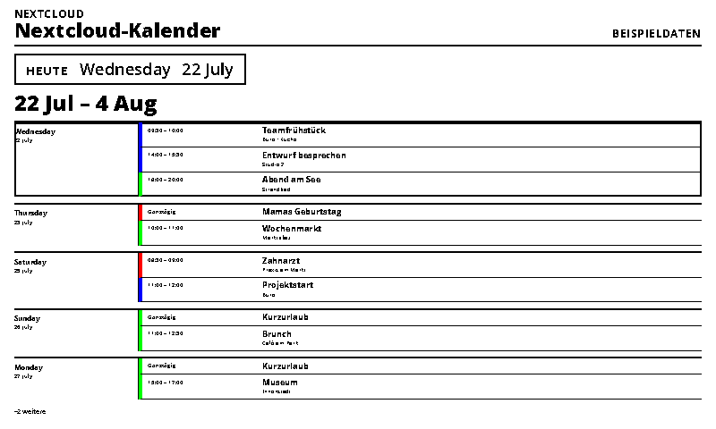
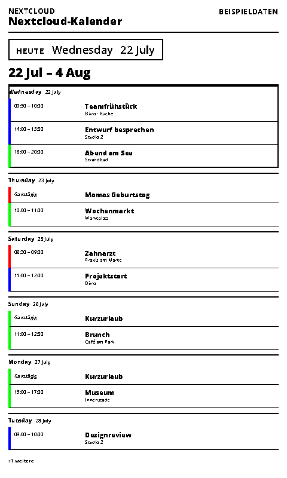
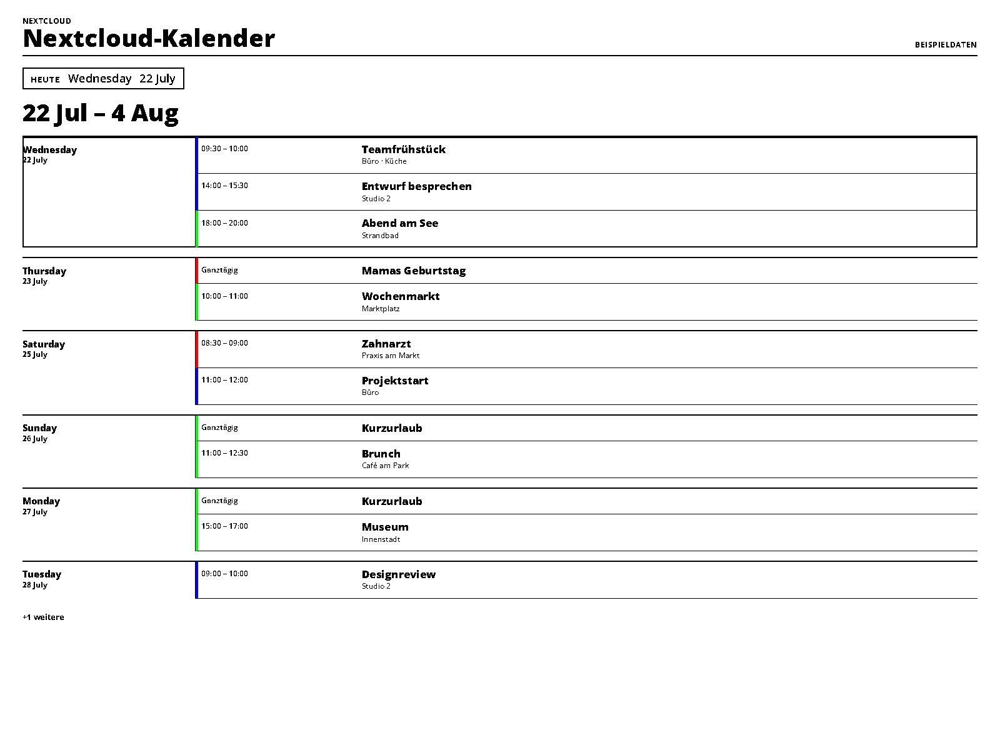
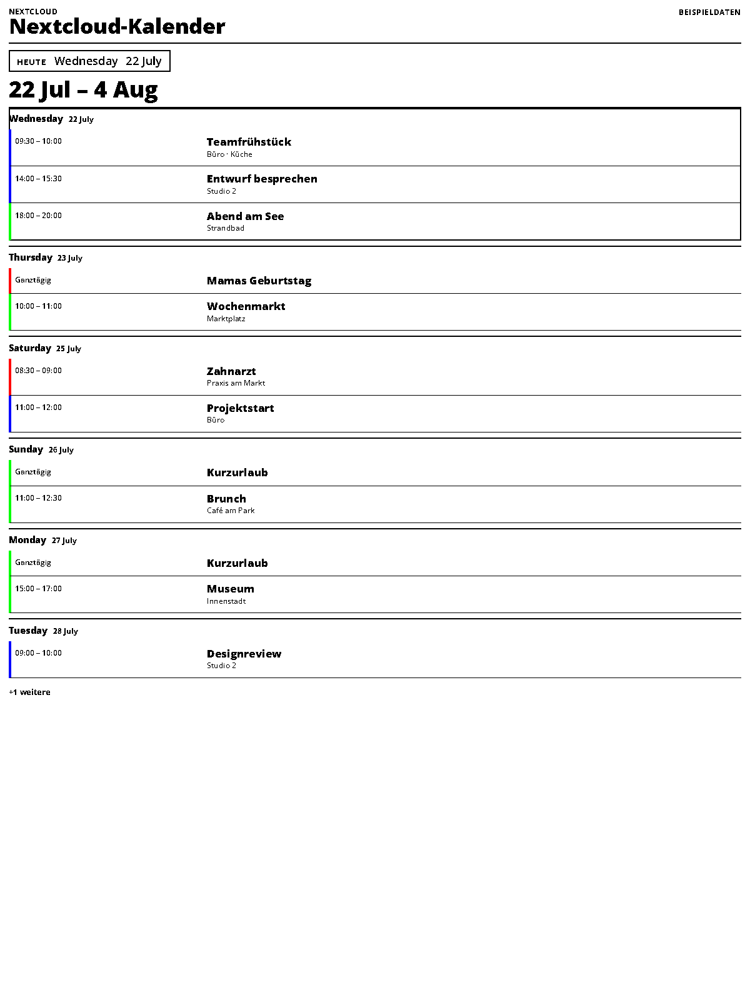
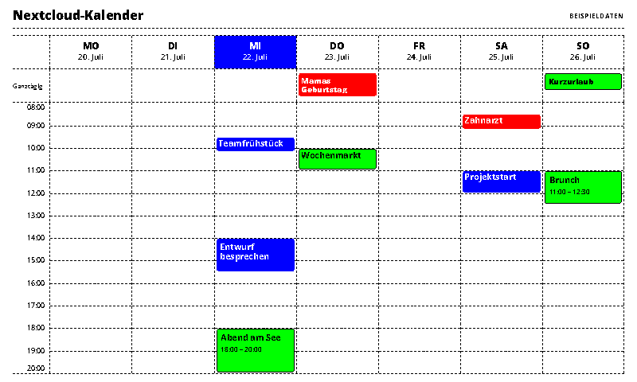
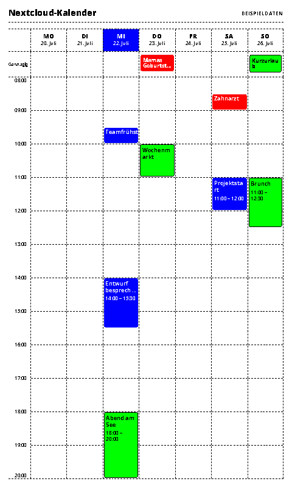
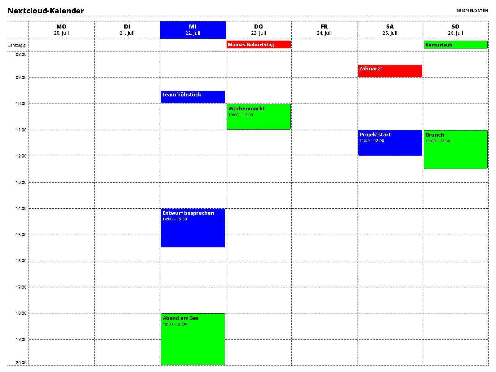
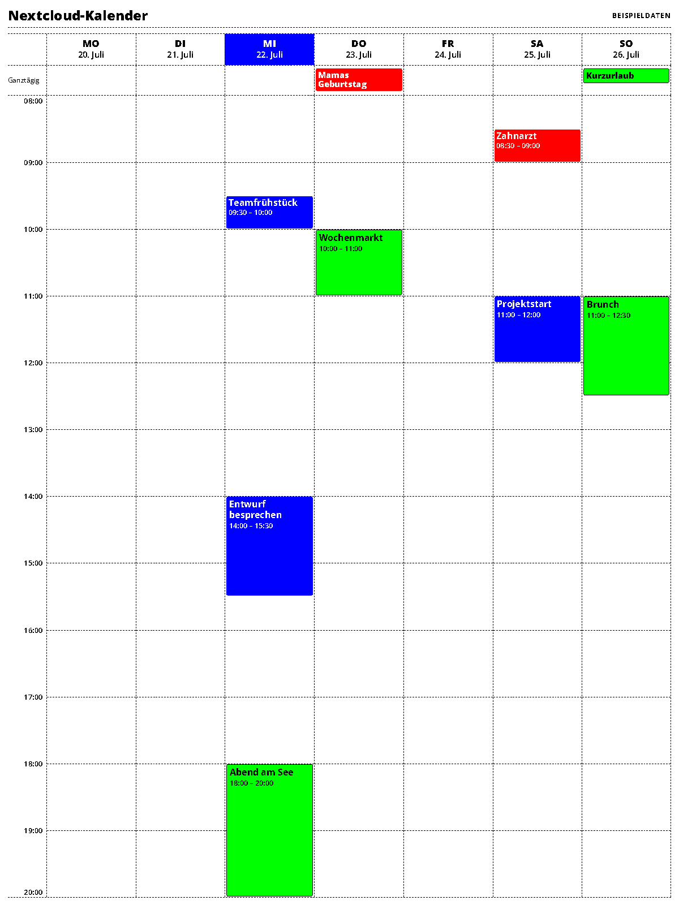

# Nextcloud Calendar

Read-only calendar integration for a private Nextcloud account. The server adapter discovers the
authenticated CalDAV principal, calendar home, and VEVENT calendars, then requests only the date
range needed by the selected shared calendar view. The render page maps no provider UI itself; it
hands normalized events to the reusable `@paperlesspaper/openintegration` calendar layout.

## Setup

1. In Nextcloud, open **Personal settings → Security → Devices & sessions** and create a dedicated
   app password for this integration.
2. Enter the base URL of the Nextcloud instance, your login username, and the app password.
3. Optionally enter an exact calendar display name. Leave it blank to select the first personal
   VEVENT calendar discovered for the account.
4. Use **Calendar path** only when display-name selection is ambiguous. It accepts a calendar URI
   such as `personal`, a path below the discovered calendar home, or a same-origin DAV path.

Do not set both **Calendar name** and **Calendar path**. When every connection field is blank, the
integration renders deterministic fictional sample events. A partially filled connection reports a
setup error instead of silently falling back to samples.

## Einstellungen (Deutsch)

1. Unter **Persönliche Einstellungen → Sicherheit → Geräte & Sitzungen** ein eigenes App-Passwort
   für diese Integration anlegen.
2. Die Basis-URL der Nextcloud-Instanz, den Anmeldenamen und das App-Passwort eintragen.
3. Optional den exakten Anzeigenamen eines Kalenders angeben. Ohne Auswahl wird der erste
   persönliche Kalender mit VEVENT-Unterstützung verwendet.
4. **Kalenderpfad** nur verwenden, wenn die Auswahl über den Namen nicht eindeutig ist. Möglich sind
   beispielsweise `personal` oder ein DAV-Pfad derselben Nextcloud-Instanz.

**Kalendername** und **Kalenderpfad** dürfen nicht gleichzeitig gesetzt sein. Sind alle
Verbindungsfelder leer, werden ausschließlich fiktive, reproduzierbare Beispieldaten angezeigt.

## Settings

- `serverUrl`: Nextcloud base URL, including a subdirectory when applicable.
- `username`: Nextcloud login username.
- `appPassword`: dedicated Nextcloud app password; never use the main account password.
- `calendarName`: optional exact calendar display name or calendar URI.
- `calendarPath`: optional same-origin DAV path used instead of `calendarName`.
- `view`: `agenda`, `agenda-modern`, `today-next`, `rolling-week-list`, `rolling-week`, `day`, `three-days`, `week`, or `year`.
- `locale`: BCP 47 locale used for visible dates and times.
- `timeZone`: IANA timezone used for date boundaries and floating iCalendar values.
- `dayRange`: number of days used by the agenda view.
- `maxEvents`: shared presentation limit. The adapter independently parses at most 200 occurrences
  for the requested range so later days are not starved by an early global display limit.
- `highlightToday`, `highlightScale`, `showLocation`: shared presentation settings.

The host-selected language comes from `payload.meta.language`; it is separate from the date-format
`locale` setting. English and German fixed UI copy are included.

## CalDAV behavior

The API performs these read-only operations:

1. `PROPFIND` for `DAV:current-user-principal`.
2. `PROPFIND` for `CALDAV:calendar-home-set`.
3. A depth-one `PROPFIND` that keeps calendar resources supporting `VEVENT`.
4. A date-bounded `calendar-query` `REPORT`. It asks Nextcloud to expand recurring events in the
   requested interval and retries without the expansion element when a server does not support it.
5. Each returned iCalendar object is parsed and recurrence-limited on the server, then mapped to the
   canonical shared event shape (`id`, `title`, `start`, `end`, and `location`).

The adapter follows at most three redirects and sends Basic credentials only to the configured
origin. Cross-origin discovery responses and redirects are rejected. Requests time out after 20
seconds; XML responses, DAV resources, discovered calendars, range length, and event occurrences
all have explicit caps.

Credentials are submitted to this integration's server-side adapter in a same-origin JSON `POST`,
so they are not placed in the URL or routine URL access logs. The password field is masking, not a
secret vault: the trusted render runtime still receives the app password, and request bodies can be
exposed by browser inspection or explicit body logging. Use only a trusted HTTPS deployment,
disable request-body logging for this endpoint, and restrict access to the integration host. The
adapter never returns the username or app password in its JSON response.

## Local validation

From the `paperlesspaper-openintegration` source repository, after the staged directory is installed
under `paperlesspaper-integrations/applications/nextcloud-calendar`:

```sh
node dist/cli.js check ../paperlesspaper-integrations/applications/nextcloud-calendar/config.json
node dist/cli.js render ../paperlesspaper-integrations/applications/nextcloud-calendar/config.json --viewport 800x480 --output /tmp/nextcloud-calendar-landscape.png
node dist/cli.js render ../paperlesspaper-integrations/applications/nextcloud-calendar/config.json --viewport 480x800 --output /tmp/nextcloud-calendar-portrait.png
```

## Official references

- [Nextcloud Calendar user manual](https://docs.nextcloud.com/server/latest/user_manual/en/groupware/calendar.html)
- [Nextcloud CalDAV address and app-password guidance](https://docs.nextcloud.com/server/latest/user_manual/en/groupware/sync_windows10.html)
- [Nextcloud calendar integration documentation](https://docs.nextcloud.com/server/latest/developer_manual/digging_deeper/groupware/calendar.html)
- [RFC 4791: Calendaring Extensions to WebDAV (CalDAV)](https://www.rfc-editor.org/rfc/rfc4791)
- [RFC 5545: Internet Calendaring and Scheduling Core Object Specification](https://www.rfc-editor.org/rfc/rfc5545)

## Calendar design options

Choose **View & design** in the integration settings:

- **Agenda (classic)** (`agenda`): the original compact chronological list.
- **Agenda (modern)** (`agenda-modern`): larger dates, open spacing and small calendar-color markers.
- **Today & next** (`today-next`): today and upcoming days, with the next or ongoing appointment highlighted.
- **Next 7 days (list)** (`rolling-week-list`): today plus six days, arranged as day lists.
- **Next 7 days (time grid)** (`rolling-week`): the same rolling week with appointments positioned by time.

The designs adapt to portrait and landscape and respect the selected color theme.
Modern agenda and Today & next use `dayRange`. Both rolling views always show seven
local dates starting today; `maxEvents` applies per day. In portrait, the rolling
time grid splits into four plus three days with the same hour scale. When space is limited, an additional-event count indicates hidden
appointments. In **Today & next**, `maxEvents` applies separately to today and the
upcoming list. Existing saved view values and the default classic agenda are preserved.

<!-- calendar-screenshots:start -->
## Screenshots

Fresh renders with fictional events. Catalog PNGs are processed for the Spectra 6 palette.

[All ten views, icons, images and event concepts](../../docs/screenshots/calendars/README.md) · [Interactive gallery](../../docs/screenshots/calendars/index.html)

| Variant | 7.3″ landscape | 7.3″ portrait | 13″ landscape | 13″ portrait |
| --- | --- | --- | --- | --- |
| Nextcloud Calendar · Agenda (classic) | [](../../docs/screenshots/calendars/providers/nextcloud-calendar-agenda-1-light-800x480-epd.png) | [](../../docs/screenshots/calendars/providers/nextcloud-calendar-agenda-1-light-480x800-epd.png) | [](../../docs/screenshots/calendars/providers/nextcloud-calendar-agenda-1-light-1600x1200-epd.png) | [](../../docs/screenshots/calendars/providers/nextcloud-calendar-agenda-1-light-1200x1600-epd.png) |
| Nextcloud Calendar · Calendar week | [](../../docs/screenshots/calendars/providers/nextcloud-calendar-week-2-blue-light-800x480-epd.png) | [](../../docs/screenshots/calendars/providers/nextcloud-calendar-week-2-blue-light-480x800-epd.png) | [](../../docs/screenshots/calendars/providers/nextcloud-calendar-week-2-blue-light-1600x1200-epd.png) | [](../../docs/screenshots/calendars/providers/nextcloud-calendar-week-2-blue-light-1200x1600-epd.png) |

<!-- calendar-screenshots:end -->

<!-- calendar-personal:start -->
## Personal calendar options

All seven calendar integrations share these independently configurable options:

| Setting | Default | Behavior |
| --- | --- | --- |
| `showDaySummary` | `false` | Remaining timed appointments (including ongoing ones), separate all-day count, next appointment and last known end today. Uses the selected timezone and shows the render/update time. |
| `automaticEventIcons` | `false` | Local German/English title rules suggest icons for birthdays, medical appointments, flights, school, shopping, calls, music, cinema, cycling, coffee and meetings. Unknown titles keep their plain appearance. |
| `showEventIcons` | `true` | Master switch for manual and automatic icons. Explicit `iconName` or `[icon:…]` takes priority over suggestions. |
| `showHeader` | `true` | Hide or show the entire provider/personal header, independently of the day summary. |
| `personalTitle` / `personalSubtitle` | empty | Override the existing heading/subtitle. Blank values retain provider defaults. Text only; maximum 100/160 characters. |
| `informationDensity` | `comfortable` | `comfortable` preserves the standard layout. `automatic` measures available space using shared `fitText`; `compact` reduces type and spacing, `spacious` enlarges them. The existing `fontSize` setting remains effective. |

Agenda, day columns, modern agenda, Today & next and rolling lists show `+ more` for whole appointments that cannot fit. Automatic modern and rolling lists grow/shrink text within a bounded range before hiding entries; classic views reuse their existing text fitting with counted overflow, while time grids retain proportional time geometry. Resizing recomputes fitting and restores entries when space becomes available. No locations or event images are silently disabled by the density setting.

The day summary uses all loaded events for today before the display's `maxEvents` limit. Ended events are excluded; an appointment without an end is counted until its start time. Missing end times, overnight appointments and all-day events suppress the last-end statement. The summary describes the loaded calendar data, not availability across other accounts; it updates when the host renders fresh data, with no per-minute display refresh.

Common icons are bundled SVG artwork and work offline. Other explicit Iconoir names use the integration's existing Iconoir stylesheet. Google accepts manual tokens in the title and description; iCalendar feeds preserve description tokens too. Outlook title tokens work without requesting extra description fields. Suggestions never rewrite source events or send titles to an external service.

Suggested setup: modern agenda or Today & next, `showDaySummary: true`, `automaticEventIcons: true`, `informationDensity: "automatic"`, and your own title. Extra features are opt-in so existing displays keep their presentation.

[Examples on 7.3-inch and 13-inch displays](../../docs/screenshots/calendars/README.md) · [Interactive gallery](../../docs/screenshots/calendars/index.html)
<!-- calendar-personal:end -->

## Minimal day timeline

Select **Day timeline (minimal)** (`view: "day-timeline"`) under **View & design**. The layout shows the current local day with a proportional time axis, native-color event rails, overlapping appointments in separate lanes and a large next-event time. In portrait, the next event and due list move below the timeline. Source calendar colors and the global light/dark theme remain active.

The visual reference is [Clean minimal calendar plugin by iUnstable0](https://www.reddit.com/r/trmnl/comments/1xhfqqt/clean_minimal_calendar_plugin/). This is an independent implementation in the shared paperlesspaper renderer; it does not use the reference project's code or server.

| Option | Default | Behavior |
| --- | --- | --- |
| `timelineShowSidebar` | `true` | Next appointment plus due/all-day list. When disabled, due/all-day entries remain above the time axis. |
| `timelineShowNow` | `true` | Red “Now” marker at render time, without a numeric clock label. It refreshes with the calendar, not continuously. |
| `timelineShowGaps` | `true` | Labels gaps between known timed commitments. All-day events, unknown end times and DST-crossing intervals suppress these labels. |
| `timelineGapMinutes` | `30` | Minimum labeled gap, configurable from 15 to 240 minutes. |

Mark a calendar event with `[todo]` in its title to put it in **Due today**. Its start/date is its due time. Google and iCalendar feeds also accept the marker in the event description. Host adapters may supply `kind: "task"` in the canonical event shape. These are read-only calendar deadlines, not a connection to Google Tasks, Microsoft To Do or iCalendar VTODO. Task deadlines do not stretch the timeline or count as occupied time. Explicitly non-busy events (`busy: false`, Google transparent events or iCalendar `TRANSP:TRANSPARENT`) do not bound free gaps.

The timeline uses the complete loaded day to establish its range and gaps even if `maxEvents` hides entries. Very short appointments retain a readable minimum height; overlapping visual blocks use lanes, and events that cannot fit in those lanes are counted in `+ more`. Location/time details are omitted from short blocks before titles are clipped. Full event time/title remain in accessible markup. The next-event panel prefers the next future appointment, then an ongoing appointment if no future one exists. Due entries are plain text rather than inactive checkboxes; ongoing appointments use only a colored rail, without an enclosing outline. Text line boxes reserve space for descenders before overflow fitting.

Existing personal heading, icon, image, font-size and information-density settings continue to apply. Choosing this view is optional and does not change the default calendar view.
