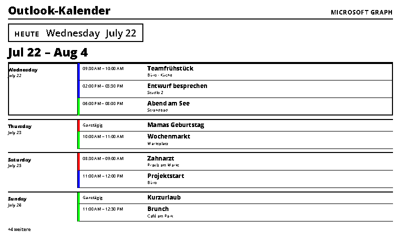
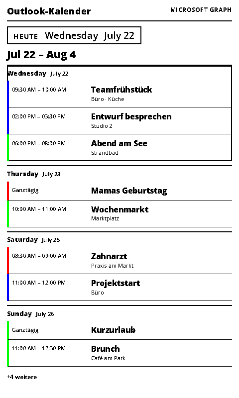
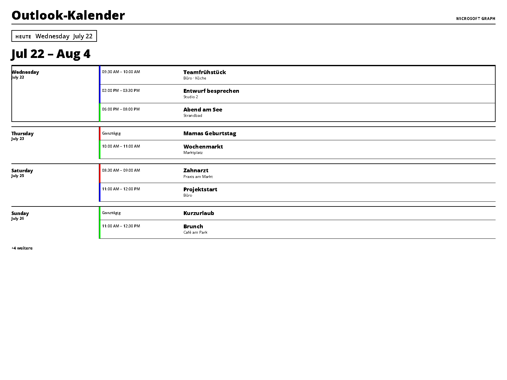
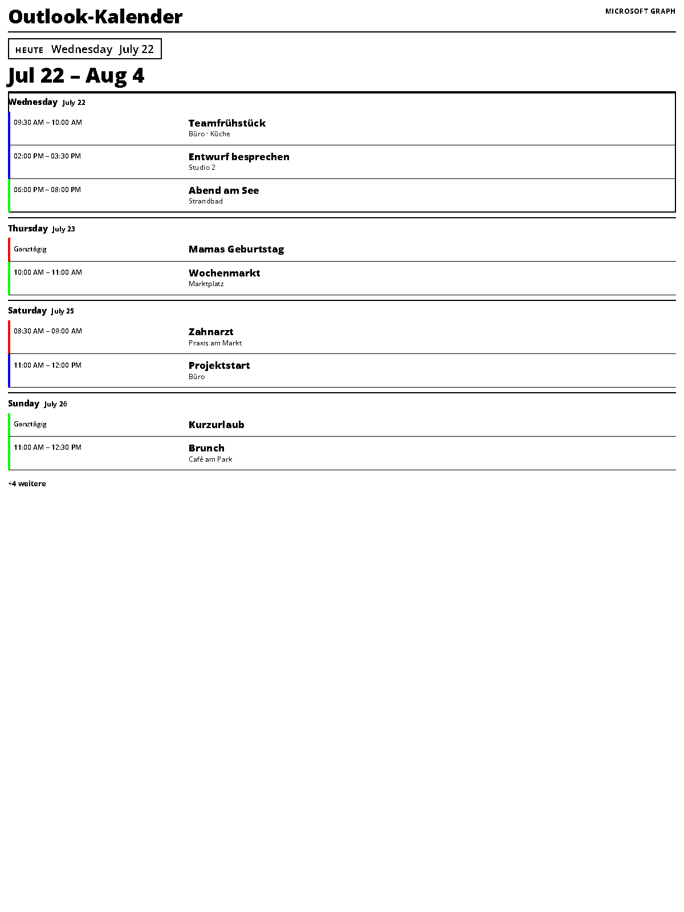
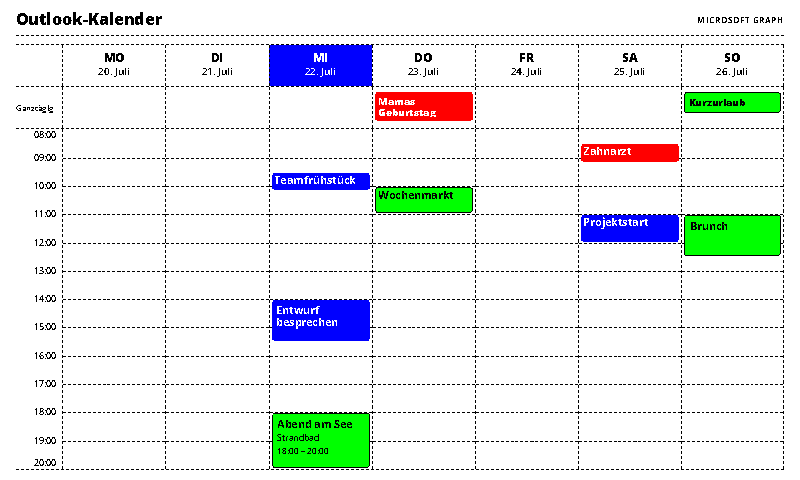
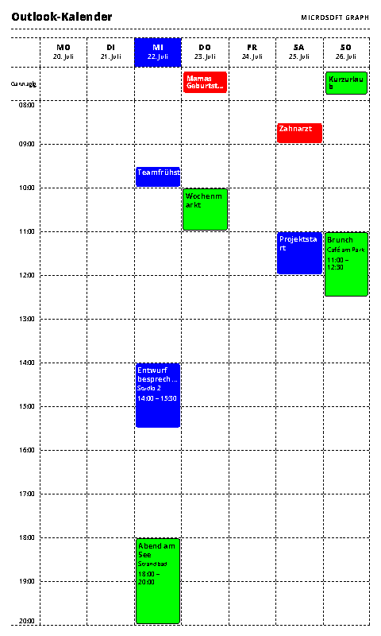
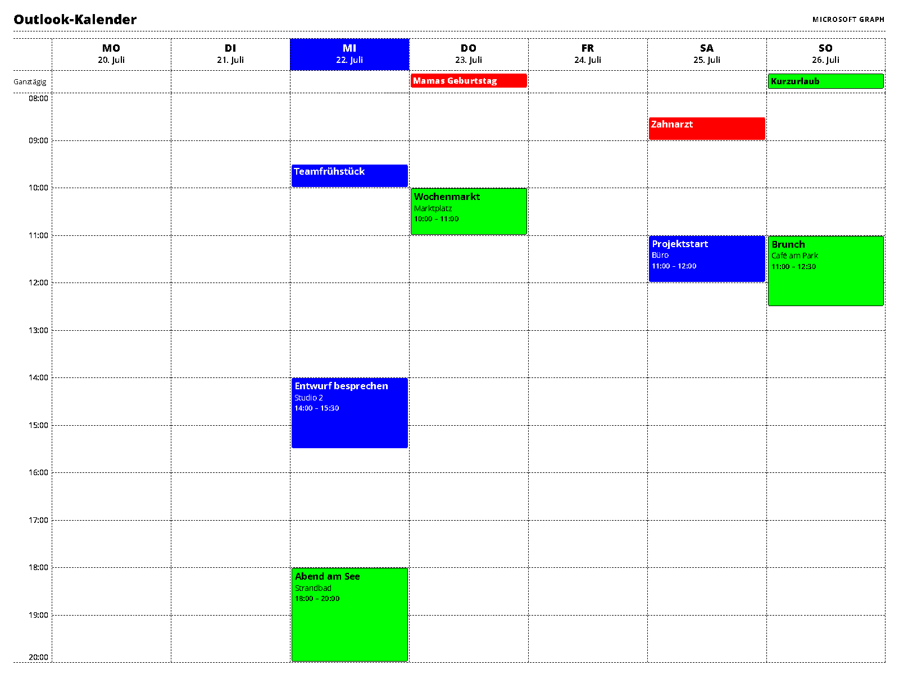
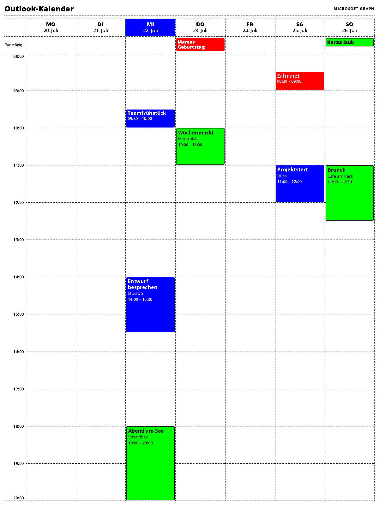

# Outlook Calendar

Displays a Microsoft 365 user's Outlook calendar with the shared paperlesspaper calendar layouts.
The integration uses the Microsoft Graph `calendarView` endpoint, so recurring events are returned
as individual occurrences and exceptions before they are mapped to the common calendar event model.

## Microsoft 365 setup

This integration currently uses the OAuth 2.0 **client credentials** flow. It is intended for a
Microsoft 365 work or school organization and does not support personal Outlook.com, Hotmail, or
Live.com calendars.

1. Register an application in Microsoft Entra ID.
2. Add the Microsoft Graph **application** permission `Calendars.ReadBasic.All`. Use
   `Calendars.Read` only if you deliberately extend the adapter to read event bodies or other data.
3. An administrator must grant tenant-wide admin consent for that application permission.
4. Create a client secret and copy its **value** immediately.
5. Configure the integration with the directory tenant ID, application client ID, client secret,
   and the user principal name or Graph user ID of the mailbox.
6. Optionally enter a Microsoft Graph calendar ID. With no calendar ID, the user's default calendar
   is used.

Microsoft's documentation:

- [Client credentials flow](https://learn.microsoft.com/en-us/graph/auth-v2-service)
- [Microsoft Graph calendarView](https://learn.microsoft.com/en-us/graph/api/calendar-list-calendarview?view=graph-rest-1.0)
- [Calendar permission definitions](https://learn.microsoft.com/en-us/graph/permissions-reference)
- [Microsoft Graph event schema](https://learn.microsoft.com/en-us/graph/api/resources/event?view=graph-rest-1.0)
- [Supported authentication scenarios](https://learn.microsoft.com/en-us/entra/identity-platform/authentication-flows-app-scenarios)

## Settings

The shared calendar settings are:

- `color`: paperlesspaper color theme.
- `view`: `agenda`, `agenda-modern`, `today-next`, `rolling-week-list`, `rolling-week`, `day`, `three-days`, `week`, or `year`.
- `locale`: BCP 47 locale used to format dates and times.
- `timeZone`: IANA timezone used for the civil query range and display, such as `Europe/Berlin`.
- `dayRange`: number of days in the agenda view.
- `maxEvents`: maximum number of visible events.
- `highlightToday` and `highlightScale`: today emphasis.
- `showLocation`: whether event locations are displayed.

The Outlook data-source settings are:

- `tenantId`, `clientId`, `clientSecret`, and `userId`: required connection credentials.
- `calendarId`: optional non-default calendar.
- `hidePrivate`: replaces private/confidential titles with “Private event” and removes their location.

Leave every connection field empty to use deterministic fictional sample events. A partially filled
connection is treated as a configuration error rather than silently falling back to sample data.

## Data and timezone behavior

`api/data.js` converts the shared renderer's civil `rangeStart` and exclusive `rangeEndExclusive`
dates to the correct UTC instants in the configured timezone. This keeps the Microsoft Graph query
correct across daylight-saving changes. Timed Graph values are normalized to ISO UTC instants and
retain the configured display timezone in the common event model. All-day events remain date-only,
with an exclusive end date, so they cannot shift into a neighboring day.

The adapter follows Microsoft Graph pagination links only on `https://graph.microsoft.com`, limits
pages and total events, rejects redirects, applies request timeouts, and skips cancelled events.

## Credential caveat

The renderer invokes `api/data.js` through a same-origin JSON `POST`, so the client secret is not
placed in the URL or routine URL access logs. Marking `clientSecret` as `format: "password"` masks
the form field, but it is **not a secret vault**: the trusted render runtime still receives the
secret, and request bodies can be exposed by browser inspection or explicit body logging. Use
HTTPS, disable request-body logging for this endpoint, restrict access to the integration host,
rotate the client secret regularly, and grant only the read-only permission needed here. Do not
put real credentials in `configVariants` or screenshots.

## Files

- `render.html`: shared calendar bootstrap plus Outlook-specific request and header mapping.
- `api/data.js`: Microsoft token exchange, Graph calendar query, pagination, privacy handling, and
  deterministic sample data.
- `languages/en.json` and `languages/de.json`: renderer copy.
- `assets/icon.png`: generated transparent catalog icon; the generation prompt is recorded in
  `../../docs/calendar-icon-generation.json`.
- `assets/icon.svg`: legacy vector illustration, independent of the generated catalog icon.

## Calendar design options

Choose **View & design** in the integration settings:

- **Agenda (classic)** (`agenda`): the original compact chronological list.
- **Agenda (modern)** (`agenda-modern`): larger dates, open spacing and small calendar-color markers.
- **Today & next** (`today-next`): today and upcoming days, with the next or ongoing appointment highlighted.
- **Next 7 days (list)** (`rolling-week-list`): today plus six days, arranged as day lists.
- **Next 7 days (time grid)** (`rolling-week`): the same rolling week with appointments positioned by time.

The designs adapt to portrait and landscape and respect the selected color theme.
Modern agenda and Today & next use `dayRange`. Both rolling views always show seven
local dates starting today; `maxEvents` applies per day. In portrait, the rolling
time grid splits into four plus three days with the same hour scale. When space is limited, an additional-event count indicates hidden
appointments. In **Today & next**, `maxEvents` applies separately to today and the
upcoming list. Existing saved view values and the default classic agenda are preserved.

<!-- calendar-screenshots:start -->
## Screenshots

Fresh renders with fictional events. Catalog PNGs are processed for the Spectra 6 palette.

[All ten views, icons, images and event concepts](../../docs/screenshots/calendars/README.md) · [Interactive gallery](../../docs/screenshots/calendars/index.html)

| Variant | 7.3″ landscape | 7.3″ portrait | 13″ landscape | 13″ portrait |
| --- | --- | --- | --- | --- |
| Outlook Calendar · Agenda (classic) |  |  |  |  |
| Outlook Calendar · Calendar week |  |  |  |  |

<!-- calendar-screenshots:end -->

<!-- calendar-personal:start -->
## Personal calendar options

All seven calendar integrations share these independently configurable options:

| Setting | Default | Behavior |
| --- | --- | --- |
| `showDaySummary` | `false` | Remaining timed appointments (including ongoing ones), separate all-day count, next appointment and last known end today. Uses the selected timezone and shows the render/update time. |
| `automaticEventIcons` | `false` | Local German/English title rules suggest icons for birthdays, medical appointments, flights, school, shopping, calls, music, cinema, cycling, coffee and meetings. Unknown titles keep their plain appearance. |
| `showEventIcons` | `true` | Master switch for manual and automatic icons. Explicit `iconName` or `[icon:…]` takes priority over suggestions. |
| `showHeader` | `true` | Hide or show the entire provider/personal header, independently of the day summary. |
| `personalTitle` / `personalSubtitle` | empty | Override the existing heading/subtitle. Blank values retain provider defaults. Text only; maximum 100/160 characters. |
| `informationDensity` | `comfortable` | `comfortable` preserves the standard layout. `automatic` measures available space using shared `fitText`; `compact` reduces type and spacing, `spacious` enlarges them. The existing `fontSize` setting remains effective. |

Agenda, day columns, modern agenda, Today & next and rolling lists show `+ more` for whole appointments that cannot fit. Automatic modern and rolling lists grow/shrink text within a bounded range before hiding entries; classic views reuse their existing text fitting with counted overflow, while time grids retain proportional time geometry. Resizing recomputes fitting and restores entries when space becomes available. No locations or event images are silently disabled by the density setting.

The day summary uses all loaded events for today before the display's `maxEvents` limit. Ended events are excluded; an appointment without an end is counted until its start time. Missing end times, overnight appointments and all-day events suppress the last-end statement. The summary describes the loaded calendar data, not availability across other accounts; it updates when the host renders fresh data, with no per-minute display refresh.

Common icons are bundled SVG artwork and work offline. Other explicit Iconoir names use the integration's existing Iconoir stylesheet. Google accepts manual tokens in the title and description; iCalendar feeds preserve description tokens too. Outlook title tokens work without requesting extra description fields. Suggestions never rewrite source events or send titles to an external service.

Suggested setup: modern agenda or Today & next, `showDaySummary: true`, `automaticEventIcons: true`, `informationDensity: "automatic"`, and your own title. Extra features are opt-in so existing displays keep their presentation.

[Examples on 7.3-inch and 13-inch displays](../../docs/screenshots/calendars/README.md) · [Interactive gallery](../../docs/screenshots/calendars/index.html)
<!-- calendar-personal:end -->

## Minimal day timeline

Select **Day timeline (minimal)** (`view: "day-timeline"`) under **View & design**. The layout shows the current local day with a proportional time axis, native-color event rails, overlapping appointments in separate lanes and a large next-event time. In portrait, the next event and due list move below the timeline. Source calendar colors and the global light/dark theme remain active.

The visual reference is [Clean minimal calendar plugin by iUnstable0](https://www.reddit.com/r/trmnl/comments/1xhfqqt/clean_minimal_calendar_plugin/). This is an independent implementation in the shared paperlesspaper renderer; it does not use the reference project's code or server.

| Option | Default | Behavior |
| --- | --- | --- |
| `timelineShowSidebar` | `true` | Next appointment plus due/all-day list. When disabled, due/all-day entries remain above the time axis. |
| `timelineShowNow` | `true` | Red “Now” marker at render time, without a numeric clock label. It refreshes with the calendar, not continuously. |
| `timelineShowGaps` | `true` | Labels gaps between known timed commitments. All-day events, unknown end times and DST-crossing intervals suppress these labels. |
| `timelineGapMinutes` | `30` | Minimum labeled gap, configurable from 15 to 240 minutes. |

Mark a calendar event with `[todo]` in its title to put it in **Due today**. Its start/date is its due time. Google and iCalendar feeds also accept the marker in the event description. Host adapters may supply `kind: "task"` in the canonical event shape. These are read-only calendar deadlines, not a connection to Google Tasks, Microsoft To Do or iCalendar VTODO. Task deadlines do not stretch the timeline or count as occupied time. Explicitly non-busy events (`busy: false`, Google transparent events or iCalendar `TRANSP:TRANSPARENT`) do not bound free gaps.

The timeline uses the complete loaded day to establish its range and gaps even if `maxEvents` hides entries. Very short appointments retain a readable minimum height; overlapping visual blocks use lanes, and events that cannot fit in those lanes are counted in `+ more`. Location/time details are omitted from short blocks before titles are clipped. Full event time/title remain in accessible markup. The next-event panel prefers the next future appointment, then an ongoing appointment if no future one exists. Due entries are plain text rather than inactive checkboxes; ongoing appointments use only a colored rail, without an enclosing outline. Text line boxes reserve space for descenders before overflow fitting.

Existing personal heading, icon, image, font-size and information-density settings continue to apply. Choosing this view is optional and does not change the default calendar view.
