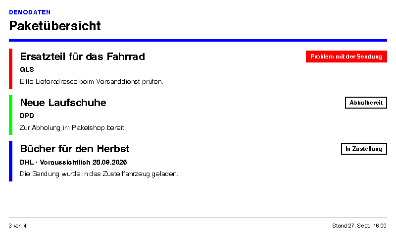
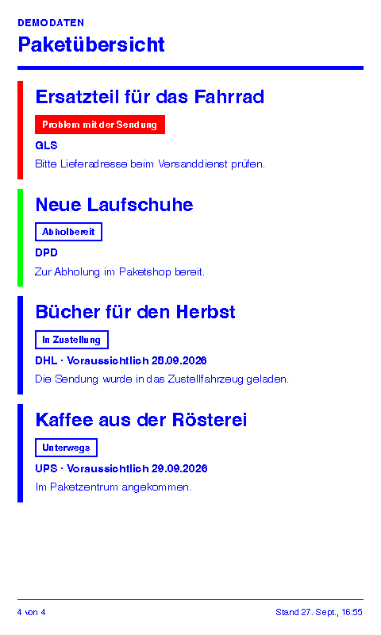

# Parcel · Paketübersicht

Displays active or recent deliveries from [Parcel](https://parcelapp.net/), with written status labels, expected delivery dates/windows and the latest supplied event. Exceptions and pickups appear first. Tracking numbers are hidden by default.

## Setup

1. Use a Parcel Premium account and create an API key at [Parcel Web](https://web.parcelapp.net/).
2. Enter the key in `apiKey`. Choose `active` or `recent`, a maximum of 1–8 deliveries, and the display timezone.
3. Keep `sampleData` disabled for your actual deliveries. Enable it explicitly for a labelled, offline demo.

Preview: `/parcel/run`. Manifest: `/parcel/config.json`.

The integration reads the [Recent & Active Deliveries API](https://parcelapp.net/help/api-view-deliveries.html). It does not create deliveries or initiate carrier refreshes. Parcel allows 20 requests per hour; identical account/filter requests are cached for 10 minutes. Recommended display refresh: 15–30 minutes. The footer's timestamp is the retrieval time, not a carrier update time.

Provider dates without timezone information remain verbatim. Epoch timestamps are formatted in the selected timezone. No delivery date or pickup deadline is invented when Parcel does not supply one. Carrier identifiers are shown as supplied by Parcel. The number shown versus total is explicit when the configured limit or available space hides deliveries.

Credentials are sent to the local adapter in a JSON POST body and upstream in the `api-key` header. Private postcodes/email fields are not returned to the renderer; tracking numbers are omitted unless enabled. A failed live request never falls back to demo data. German and English UI; provider text remains in its source language.

## Verification

`npm run check:parcel-readwise-movies` checks manifests, adapters, four display sizes in light/dark themes, host updates, long text, empty states and provider errors. Add `-- --render` to regenerate the eight production-like Spectra 6 screenshots.

The integration icon is a generated, square 1254×1254 PNG with transparent alpha, copied directly from built-in ImageGen output. The earlier SVG is retained only as a vector draft. [Generation prompts and provenance](../../docs/parcel-readwise-movies-icon-prompts.md).

[All screenshots and generated icons](../../docs/parcel-readwise-movies-assets.md).
