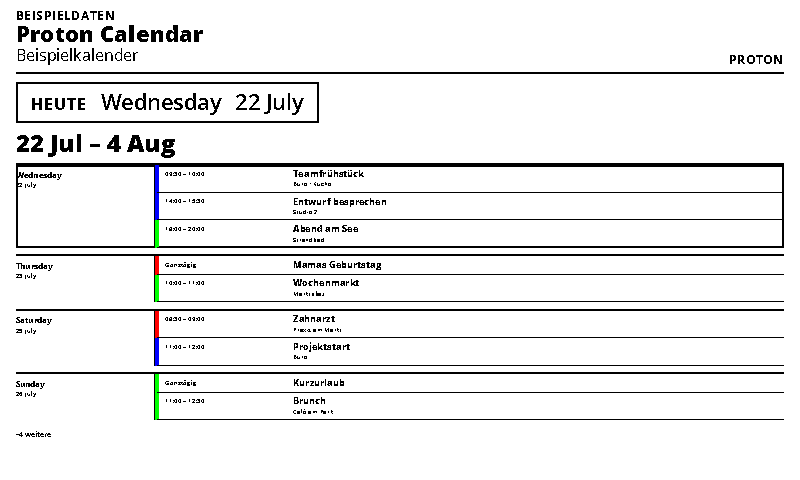
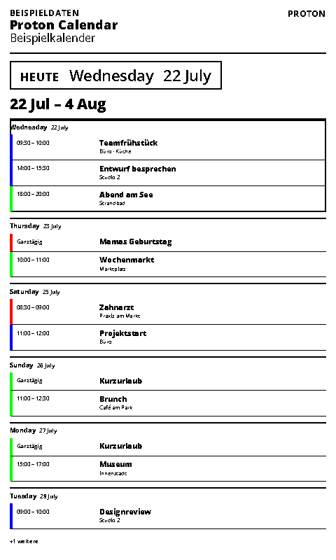
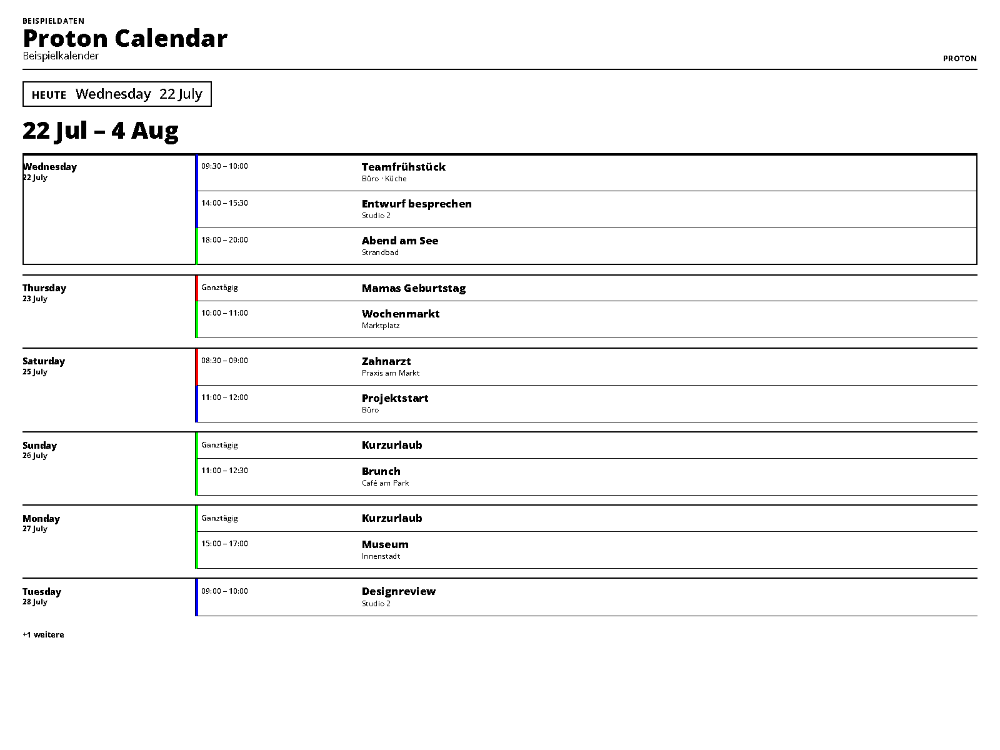
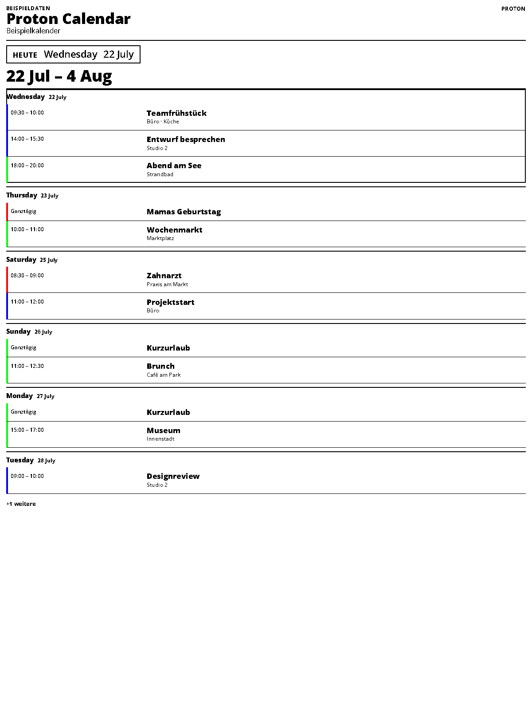

# Proton Calendar

Displays a Proton Calendar using its read-only **Share with anyone** link. The adapter downloads and expands iCalendar data on the server, maps it into the reusable calendar model, and shares all display views and settings with the other calendar integrations.

## Setup and supported access

1. In the Proton Calendar web app, open Settings → Calendars.
2. Under **Share with anyone**, create either a Limited view or Full view link.
3. Paste the link into `calendarUrl`.

Proton documents these links as its supported way to subscribe from third-party calendars. Proton does not provide CalDAV access, so this integration intentionally does not collect Proton credentials or use a private API. See [Proton's sharing guide](https://proton.me/support/share-calendar-via-link) and [Proton's external calendar/CalDAV statement](https://proton.me/support/subscribe-to-external-calendar).

**Share with anyone requires a paid Proton plan.** Proton currently allows up to five sharing links per calendar; Limited-view and Full-view links both count toward that limit.

Limited links expose only the busy information present in the feed. Full-view links include titles, descriptions, participants, and locations and contain the key required to decrypt the shared calendar. This integration displays only title, time, and optional location.

Proton notes that link updates can take up to eight hours and that a third-party subscription can occasionally stop refreshing; generating a new sharing link is their documented recovery step.

## Shared calendar settings

`view`, `locale`, `timeZone`, `dayRange`, `maxEvents`, `highlightToday`, `highlightScale`, and `showLocation` are handled by the common calendar toolkit. Supported views are `agenda`, `agenda-modern`, `today-next`, `rolling-week-list`, `rolling-week`, `day`, `three-days`, `week`, and `year`.

The server adapter uses the shared iCalendar parser for folded text, date and timezone values, recurrence rules, exclusions, moved occurrences, and cancellations. `maxEvents` remains a presentation limit; the adapter independently keeps up to 500 normalized events so later days are not starved. Fetches have strict Proton host checks plus redirect, timeout, response-size, source-event, and occurrence limits.

## Privacy note

Treat the sharing URL like a password. The form masks it and sends it to the same-origin adapter in a JSON POST body, keeping it out of URL query strings and ordinary URL access logs. The trusted render runtime and adapter server still receive the link, so run the integration only over trusted HTTPS and do not log request bodies. Delete the link in Proton Calendar to revoke access.

## Local verification

```sh
node dist/cli.js check ../paperlesspaper-integrations/applications/proton-calendar/config.json
node dist/cli.js render ../paperlesspaper-integrations/applications/proton-calendar/config.json --viewport 800x480 --output /tmp/proton-calendar-landscape.png
node dist/cli.js render ../paperlesspaper-integrations/applications/proton-calendar/config.json --viewport 480x800 --output /tmp/proton-calendar-portrait.png
```

## Calendar design options

Choose **View & design** in the integration settings:

- **Agenda (classic)** (`agenda`): the original compact chronological list.
- **Agenda (modern)** (`agenda-modern`): larger dates, open spacing and small calendar-color markers.
- **Today & next** (`today-next`): today and upcoming days, with the next or ongoing appointment highlighted.
- **Next 7 days (list)** (`rolling-week-list`): today plus six days, arranged as day lists.
- **Next 7 days (time grid)** (`rolling-week`): the same rolling week with appointments positioned by time.

The designs adapt to portrait and landscape and respect the selected color theme.
Modern agenda and Today & next use `dayRange`. Both rolling views always show seven
local dates starting today; `maxEvents` applies per day. In portrait, the rolling
time grid splits into four plus three days with the same hour scale. When space is limited, an additional-event count indicates hidden
appointments. In **Today & next**, `maxEvents` applies separately to today and the
upcoming list. Existing saved view values and the default classic agenda are preserved.

<!-- calendar-screenshots:start -->
## Screenshots

Fresh renders with fictional events. Catalog PNGs are processed for the Spectra 6 palette.

[All ten views, icons, images and event concepts](../../docs/screenshots/calendars/README.md) · [Interactive gallery](../../docs/screenshots/calendars/index.html)

| Variant | 7.3″ landscape | 7.3″ portrait | 13″ landscape | 13″ portrait |
| --- | --- | --- | --- | --- |
| Proton Calendar · Agenda (classic) | [](../../docs/screenshots/calendars/providers/proton-calendar-agenda-1-light-800x480-epd.png) | [](../../docs/screenshots/calendars/providers/proton-calendar-agenda-1-light-480x800-epd.png) | [](../../docs/screenshots/calendars/providers/proton-calendar-agenda-1-light-1600x1200-epd.png) | [](../../docs/screenshots/calendars/providers/proton-calendar-agenda-1-light-1200x1600-epd.png) |

<!-- calendar-screenshots:end -->

<!-- calendar-personal:start -->
## Personal calendar options

All seven calendar integrations share these independently configurable options:

| Setting | Default | Behavior |
| --- | --- | --- |
| `showDaySummary` | `false` | Remaining timed appointments (including ongoing ones), separate all-day count, next appointment and last known end today. Uses the selected timezone and shows the render/update time. |
| `automaticEventIcons` | `false` | Local German/English title rules suggest icons for birthdays, medical appointments, flights, school, shopping, calls, music, cinema, cycling, coffee and meetings. Unknown titles keep their plain appearance. |
| `showEventIcons` | `true` | Master switch for manual and automatic icons. Explicit `iconName` or `[icon:…]` takes priority over suggestions. |
| `showHeader` | `true` | Hide or show the entire provider/personal header, independently of the day summary. |
| `personalTitle` / `personalSubtitle` | empty | Override the existing heading/subtitle. Blank values retain provider defaults. Text only; maximum 100/160 characters. |
| `informationDensity` | `comfortable` | `comfortable` preserves the standard layout. `automatic` measures available space using shared `fitText`; `compact` reduces type and spacing, `spacious` enlarges them. The existing `fontSize` setting remains effective. |

Agenda, day columns, modern agenda, Today & next and rolling lists show `+ more` for whole appointments that cannot fit. Automatic modern and rolling lists grow/shrink text within a bounded range before hiding entries; classic views reuse their existing text fitting with counted overflow, while time grids retain proportional time geometry. Resizing recomputes fitting and restores entries when space becomes available. No locations or event images are silently disabled by the density setting.

The day summary uses all loaded events for today before the display's `maxEvents` limit. Ended events are excluded; an appointment without an end is counted until its start time. Missing end times, overnight appointments and all-day events suppress the last-end statement. The summary describes the loaded calendar data, not availability across other accounts; it updates when the host renders fresh data, with no per-minute display refresh.

Common icons are bundled SVG artwork and work offline. Other explicit Iconoir names use the integration's existing Iconoir stylesheet. Google accepts manual tokens in the title and description; iCalendar feeds preserve description tokens too. Outlook title tokens work without requesting extra description fields. Suggestions never rewrite source events or send titles to an external service.

Suggested setup: modern agenda or Today & next, `showDaySummary: true`, `automaticEventIcons: true`, `informationDensity: "automatic"`, and your own title. Extra features are opt-in so existing displays keep their presentation.

[Examples on 7.3-inch and 13-inch displays](../../docs/screenshots/calendars/README.md) · [Interactive gallery](../../docs/screenshots/calendars/index.html)
<!-- calendar-personal:end -->

## Minimal day timeline

Select **Day timeline (minimal)** (`view: "day-timeline"`) under **View & design**. The layout shows the current local day with a proportional time axis, native-color event rails, overlapping appointments in separate lanes and a large next-event time. In portrait, the next event and due list move below the timeline. Source calendar colors and the global light/dark theme remain active.

The visual reference is [Clean minimal calendar plugin by iUnstable0](https://www.reddit.com/r/trmnl/comments/1xhfqqt/clean_minimal_calendar_plugin/). This is an independent implementation in the shared paperlesspaper renderer; it does not use the reference project's code or server.

| Option | Default | Behavior |
| --- | --- | --- |
| `timelineShowSidebar` | `true` | Next appointment plus due/all-day list. When disabled, due/all-day entries remain above the time axis. |
| `timelineShowNow` | `true` | Red “Now” marker at render time, without a numeric clock label. It refreshes with the calendar, not continuously. |
| `timelineShowGaps` | `true` | Labels gaps between known timed commitments. All-day events, unknown end times and DST-crossing intervals suppress these labels. |
| `timelineGapMinutes` | `30` | Minimum labeled gap, configurable from 15 to 240 minutes. |

Mark a calendar event with `[todo]` in its title to put it in **Due today**. Its start/date is its due time. Google and iCalendar feeds also accept the marker in the event description. Host adapters may supply `kind: "task"` in the canonical event shape. These are read-only calendar deadlines, not a connection to Google Tasks, Microsoft To Do or iCalendar VTODO. Task deadlines do not stretch the timeline or count as occupied time. Explicitly non-busy events (`busy: false`, Google transparent events or iCalendar `TRANSP:TRANSPARENT`) do not bound free gaps.

The timeline uses the complete loaded day to establish its range and gaps even if `maxEvents` hides entries. Very short appointments retain a readable minimum height; overlapping visual blocks use lanes, and events that cannot fit in those lanes are counted in `+ more`. Location/time details are omitted from short blocks before titles are clipped. Full event time/title remain in accessible markup. The next-event panel prefers the next future appointment, then an ongoing appointment if no future one exists. Due entries are plain text rather than inactive checkboxes; ongoing appointments use only a colored rail, without an enclosing outline. Text line boxes reserve space for descenders before overflow fitting.

Existing personal heading, icon, image, font-size and information-density settings continue to apply. Choosing this view is optional and does not change the default calendar view.
