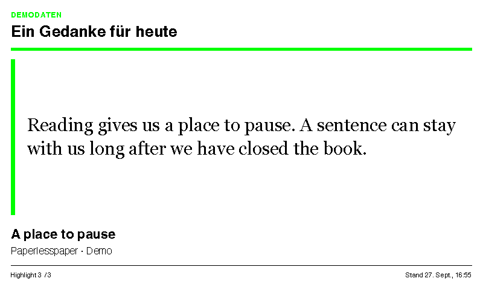
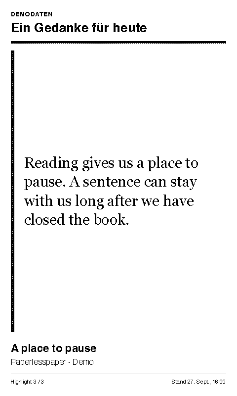

# Readwise

A quiet reading card with one highlight from your latest Readwise Daily Review, its title and author, and an optional personal note.

## Setup

Get your [Readwise access token](https://readwise.io/access_token), enter it in `apiToken`, and leave `sampleData` disabled. An account with API access and a Daily Review is required. Preview: `/readwise/run`. Manifest: `/readwise/config.json`.

- `rotation`: `daily` (default), `hourly`, or `fixed`.
- `highlightIndex`: zero-based offset within the current review. With `fixed`, selects a specific position.
- `showNote`: include the personal note.
- `timeZone`: timezone used for day/hour rotation and retrieval timestamps.
- `title`, global `color`, and explicit labelled `sampleData` are also available.

The adapter calls only [GET /api/v2/review/](https://readwise.io/api_deets#daily-review-list) using header authentication. It never completes reviews, updates highlights, or fetches the entire library. Rotation applies to the latest review returned by Readwise; it does not generate a new review. A 404/no review becomes a helpful empty state. Authentication/network errors remain errors, with no demo fallback. Identical account requests are cached for 15 minutes. Recommended refresh: hourly or daily.

Long highlights shrink only to a readable minimum; if necessary, the displayed passage ends in an ellipsis and the footer says “Auszug”/“Excerpt”. Titles, authors and personal notes have bounded display space. UI text supports German and English; original highlights are not translated. Demo passages are original fictional examples by Paperlesspaper.

## Verification

`npm run check:parcel-readwise-movies` checks adapters and layouts, including timezone boundaries, long passages, later INIT updates and errors. Add `-- --render` to regenerate Spectra 6 output in both orientations and colored light/dark themes at four resolutions.

The integration icon is a generated, square 1254×1254 PNG with transparent alpha, copied directly from built-in ImageGen output. The earlier SVG is retained only as a vector draft. [Generation prompts and provenance](../../docs/parcel-readwise-movies-icon-prompts.md).

[All screenshots and generated icons](../../docs/parcel-readwise-movies-assets.md).
