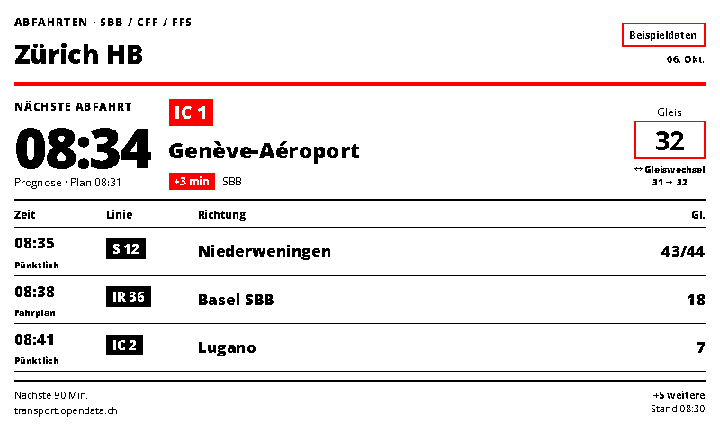
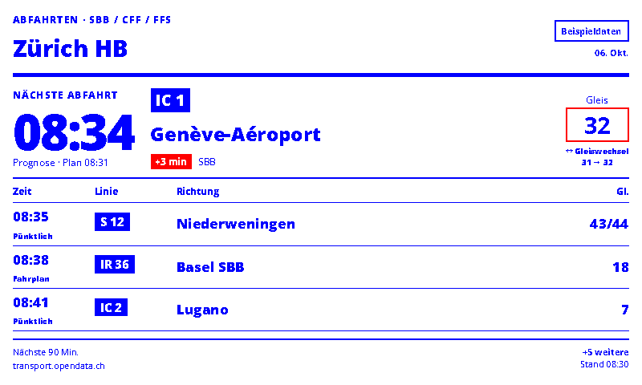
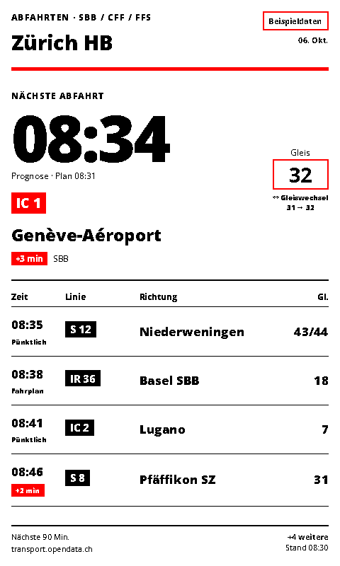
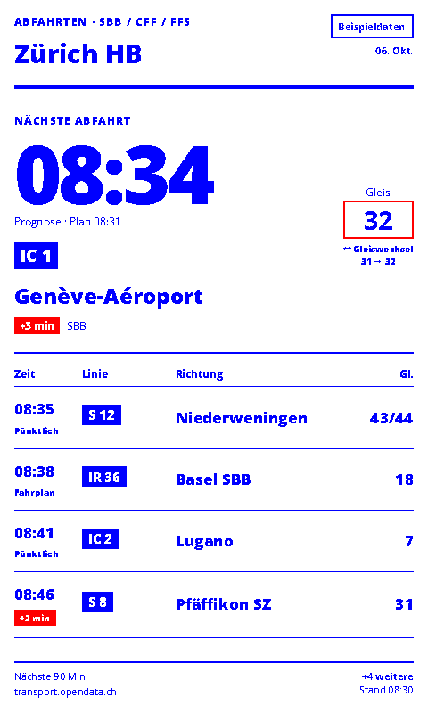

# SBB Abfahrten

Swiss public transport departures for paperlesspaper, implementing [issue #96](https://github.com/paperlesspaper/paperlesspaper-apps/issues/96). Choose a Swiss station or stop to show the next departure, followed by a compact board with line, destination, expected departure, available delay and platform information. SBB and other operators are included where the provider supplies them.

SBB and DB share `bootDepartureIntegration()` from
`@paperlesspaper/openintegration`. Layout, typography, status labels and fitting
are maintained in the sibling library's `src/departures.ts` and
`src/styles/paperless.css`. Provider fetching and filters stay in their API
adapters. Text gets sufficient line height and ink padding to preserve descenders
such as the g in Niederweningen. See the
[shared visual comparison](../../docs/screenshots/departures/README.md).

## Setup

No account or API key is required. Set `stationName` to e.g. **Zürich HB**, **Bern** or **Basel SBB**. For an unambiguous selection, set `stationId` instead: `8503000`, `8507000` or `8500010`, respectively. A station ID overrides the name. The heading displays the station actually resolved by the provider.

Use the host's refresh schedule to refresh the image; the integration does not poll in the browser. A refresh every few minutes is suitable for a departure snapshot. The displayed `Stand` / `Updated` time is the data retrieval time, including when a cached response is used, not an upstream real-time measurement timestamp. Times are always displayed in `Europe/Zurich`, including daylight-saving changes.

## Settings

| Setting | Default | Meaning |
| --- | --- | --- |
| `stationName` | Zürich HB | Name of the departure station or stop. |
| `stationId` | empty | Optional numeric provider station ID; overrides the name. |
| `duration` | 90 | Lookahead in minutes, bounded to 10–360. |
| `limit` | 7 | Maximum displayed departures, bounded to 1–12. Whole rows that cannot fit are counted in `+ more`. |
| `transport` | all | All modes, or train, tram, bus, ship or cableway. Sent upstream. |
| `destination` | empty | Case/accent-insensitive partial match on final destination or later stops. Direct services only; no transfer search. |
| `lines` | empty | Comma-separated exact lines, e.g. `IC 1, S12`; spaces and case are ignored. |
| `showPlatformChanges` | true | Show a written change notice and old/new platforms on the next departure; other rows use a ↔ marker. |
| `sampleData` | false | Explicit fictional Zürich HB preview, clearly labelled. Fixed station and train examples; destination and line filters still apply. Never used as an error fallback. |
| `color` | red-light | Global host theme. Colored light and dark themes are supported. |

German, English, French and Italian display labels follow the host language. Station names and operator names remain as supplied by the source. The settings schema uses English labels.

## Data and limitations

The adapter uses [`transport.opendata.ch/v1/stationboard`](https://transport.opendata.ch/docs.html#stationboard), an independent public Swiss Transport API. This integration is not an official SBB product and does not directly consume the authenticated SIRI/GTFS-RT feeds linked in the issue. Provider availability and forecast coverage vary.

- Requests are cached for 30 seconds with a bounded response size and network deadline using the repository's shared HTTP helper.
- Each request asks for the next **100 departures**. The adapter filters this bounded board by time, line and destination, sorts by expected departure and applies the display limit last. Busy stations or narrow filters may not cover the whole requested time window; reaching the fetch limit is labelled as a limited timetable extract.
- A supplied departure prognosis takes precedence over the reported delay. Without either, the departure is labelled **Fahrplan / Timetable**, never **Pünktlich / On time**. The large next-departure time is the expected time; when it differs, the planned time is also shown.
- Platform changes are shown only when the source provides both planned and different forecast platforms. Missing platforms show `—`.
- This endpoint does not document a reliable cancellation flag. The integration does not infer cancellations or provide a complete disruption report. It also does not promise occupancy data or connection planning.
- Source failures and unknown stations show a localized error state. Valid responses with no matching departures show a distinct empty state.
- Long destination names are shortened visually where needed. Filters operate on the normalized provider text before display fitting.

## Screenshots

Fictional examples, processed with the production-like Spectra 6 renderer:

| Light | Dark |
| --- | --- |
|  |  |
|  |  |

The icon in `assets/icon.png` was generated with the built-in Imagegen tool following the paperlesspaper icon guide: a red-and-white Swiss train with subtle 3D shading and a genuinely transparent background. The generated PNG is copied unchanged. The complete prompt and provenance are in [sbb-icon-generation.json](../../docs/sbb-icon-generation.json). The earlier `assets/icon.svg` is an independent legacy illustration, not the source of the generated PNG.

## Local verification

```sh
npx paperless check applications/sbb-abfahrten/config.json
node --test tests/sbb-abfahrten.test.mjs
node scripts/check-sbb-layouts.mjs
npm run screenshots -- --app sbb-abfahrten
npx paperless dev applications/sbb-abfahrten/config.json
```

The layout check now runs both DB and SBB: 180 combinations of language, theme and display size, plus long untrusted text, empty responses, errors and repeated INIT updates. A pixel comparison with overflow disabled verifies that no glyph ink is lost from Niederweningen in station headers, the main destination or list rows. Screenshots cover 800×480, 480×800, 1600×1200 and 1200×1600 in red-light and blue-dark.
