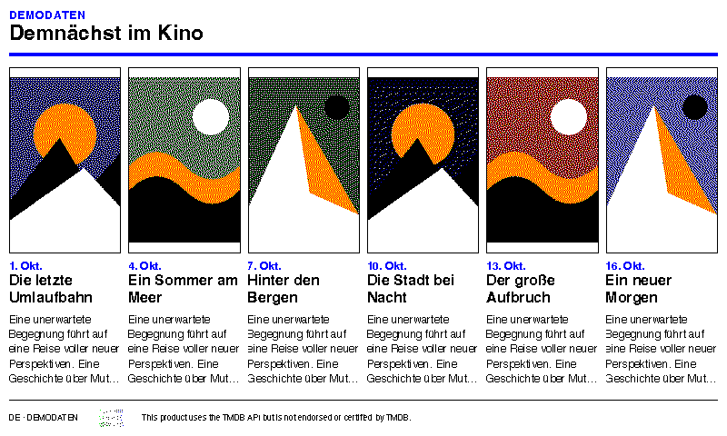
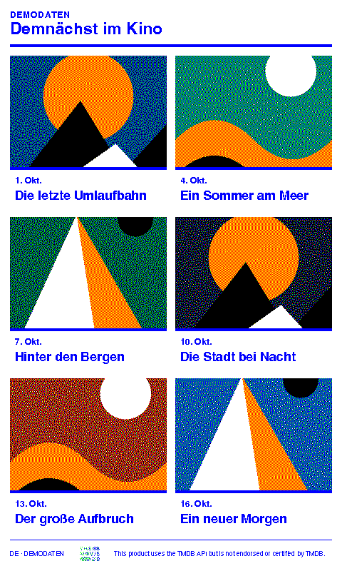

# Upcoming Movies · Kino-Filmvorschau

Migrates the movie preview from `paperlesspaper-apps` into a standalone OpenIntegration. Source: `src/components/UpcomingMovies/UpcomingMovies.tsx`, its SCSS, and `src/app/api/upcomingmovies/route.ts` in that sibling repository.

The display preserves the original poster-led concept: a row of posters with release date, title and synopsis in landscape; two columns with compact title/date captions in portrait. The default remains six films; `count` supports 1–6. Images and fonts settle before the ready marker, and missing or failed posters have a visible fallback.

## Runtime

The migrated integration uses plain HTML/CSS and ES modules (`assets/render.js`, `assets/defaults.js`) plus the shared OpenIntegration browser helper. It has no React, ReactDOM, JSX/TSX or Next.js runtime dependency and needs no frontend build. The TSX path above identifies the historical migration source only.

## Setup and migration

- Preview: `/upcoming-movies/run`; install manifest: `/upcoming-movies/config.json`.
- Set the existing `TMDB_API_KEY` environment variable on the integrations server. The server reads the local `.env`; Docker Compose already loads that file. Restart the server/container after changing it.
- Alternatively set `apiKey` per display. A nonempty display key takes precedence over the server key.
- Replace the old `/upcomingmovies` website integration with this manifest. Preserve `count` and `color`; language now comes from the host's language setting. The old `accent` query argument had no active rendering behavior and is not migrated.
- `region` defaults to `DE` and accepts a two-letter release country code. TMDB may fall back to its primary release date when regional metadata is unavailable.
- `showOverview` controls landscape synopses. Portrait intentionally stays poster-focused, like the old app.
- Enable `sampleData` only for labelled offline previews. All six demo films and their geometric poster illustrations are fictional.

The adapter retains TMDB's [upcoming endpoint](https://developer.themoviedb.org/reference/movie-upcoming-list), now over HTTPS, and the old language mapping. It adds regional selection and a six-hour cache. German/English UI is included. Recommended display refresh: every 6–24 hours. Provider failures remain errors rather than a misleading empty gallery.

This migration adds the new implementation here. It does not remove or redirect the old Next.js route, change existing devices, or deploy either repository.

## Attribution

This product uses the TMDB API but is not endorsed or certified by TMDB.

Movie metadata and live posters are supplied by [TMDB](https://www.themoviedb.org/). The unmodified TMDB logo in `assets/tmdb.svg` comes from its [approved logo assets](https://www.themoviedb.org/about/logos-attribution): `https://www.themoviedb.org/assets/2/v4/logos/v2/blue_square_2-d537fb228cf3ded904ef09b136fe3fec72548ebc1fea3fbbd1ad9e36364db38b.svg`.

The fictional demo posters are original vector artwork. The integration icon is a generated, square 1254×1254 PNG with transparent alpha, copied directly from built-in ImageGen output. The earlier SVG is retained only as a vector draft. [Generation prompts and provenance](../../docs/parcel-readwise-movies-icon-prompts.md).

## Verification

`npm run check:parcel-readwise-movies` validates adapters, token fallback, host INIT updates, text escaping, empty/error states and all four display resolutions. Add `-- --render` to regenerate production-like Spectra 6 screenshots with error diffusion in colored light/dark themes.

[All screenshots and generated icons](../../docs/parcel-readwise-movies-assets.md).
