# Screenshots und Icons: Parcel, Readwise und Kino

Die Screenshots werden mit dem OpenIntegration-Renderer aus den tatsächlichen HTML-Seiten erzeugt und für Spectra 6 mit Error Diffusion verarbeitet. Die konfigurierten Beispiele sind als Demodaten gekennzeichnet.

Pro Integration gibt es zwei globale Farbvarianten in 800×480, 480×800, 1600×1200 und 1200×1600. Die Farbnamen entsprechen unverändert dem gemeinsamen Theme.

Die Icons wurden einzeln mit dem eingebauten ImageGen-Werkzeug erzeugt: quadratische PNGs mit echtem Alphakanal, ohne Schrift oder Hintergrundszene. [Prompts und Herkunft](parcel-readwise-movies-icon-prompts.md).

Neu erzeugen: `npm run check:parcel-readwise-movies -- --render`.

## Paketübersicht

[Manifest](../applications/parcel/config.json) · [Einrichtung](../applications/parcel/README.md)

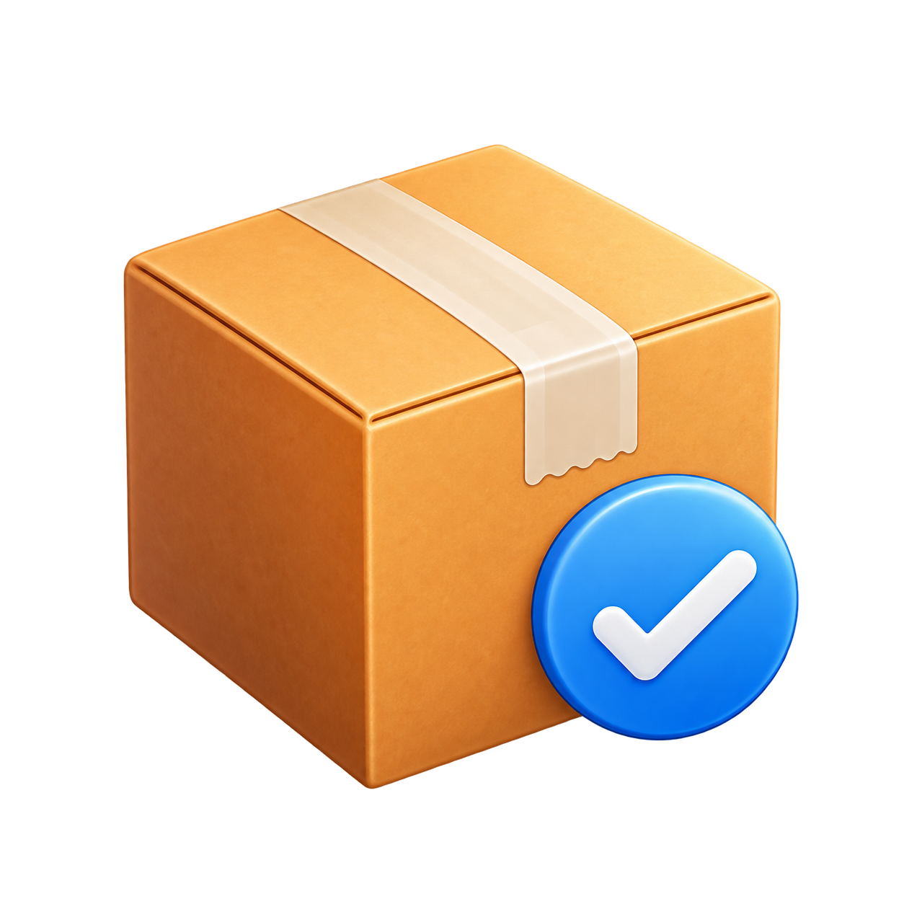

[Icon PNG](../applications/parcel/assets/icon.png)

| Variante | Querformat | Hochformat |
| --- | --- | --- |
| Standard | 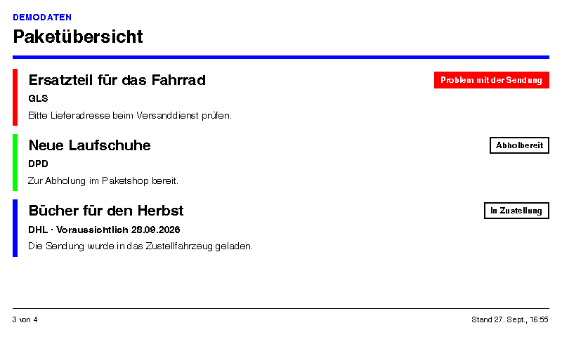 | 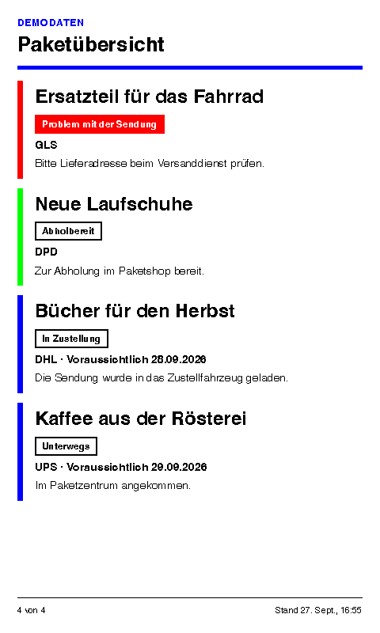 |
| Alternative Farbvariante | 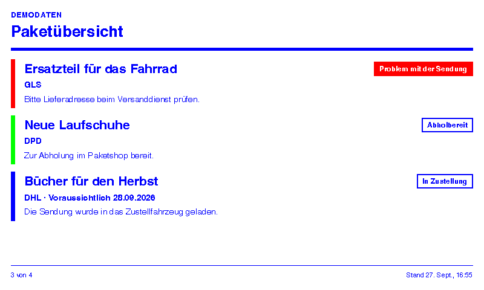 | 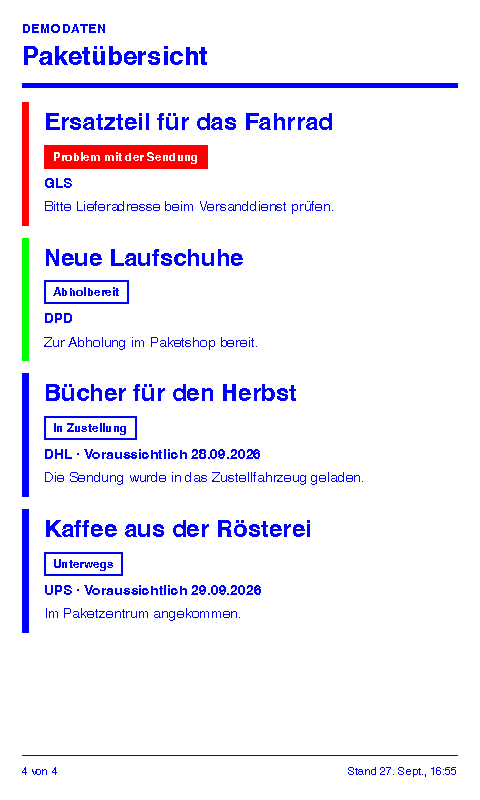 |

Große Formate: [default 1600x1200](../applications/parcel/screenshots/parcel-default-1600x1200.png) · [default 1200x1600](../applications/parcel/screenshots/parcel-default-1200x1600.png) · [dark 1600x1200](../applications/parcel/screenshots/parcel-dark-1600x1200.png) · [dark 1200x1600](../applications/parcel/screenshots/parcel-dark-1200x1600.png)

## Readwise

[Manifest](../applications/readwise/config.json) · [Einrichtung](../applications/readwise/README.md)

[Icon PNG](../applications/readwise/assets/icon.png)

| Variante | Querformat | Hochformat |
| --- | --- | --- |
| Standard | 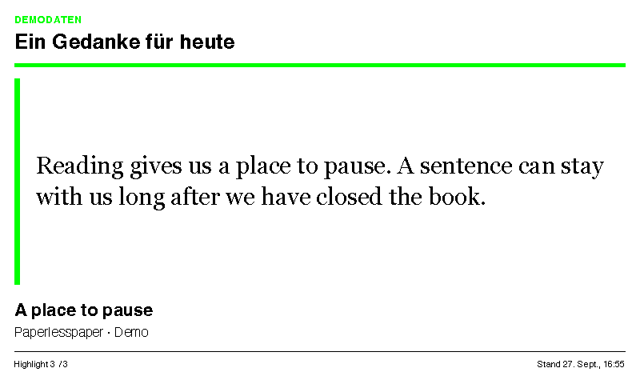 | 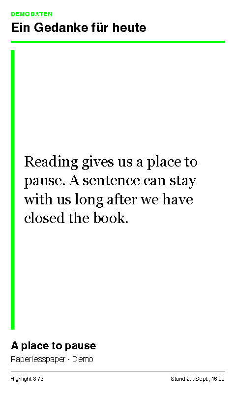 |
| Alternative Farbvariante | 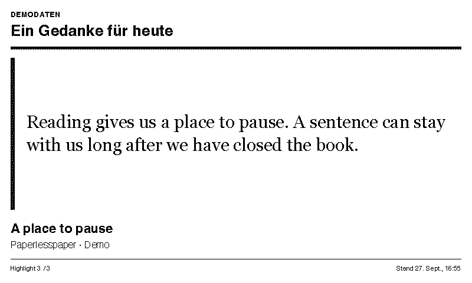 | 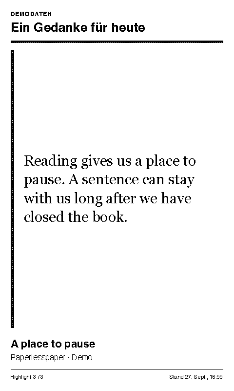 |

Große Formate: [default 1600x1200](../applications/readwise/screenshots/readwise-default-1600x1200.png) · [default 1200x1600](../applications/readwise/screenshots/readwise-default-1200x1600.png) · [dark 1600x1200](../applications/readwise/screenshots/readwise-dark-1600x1200.png) · [dark 1200x1600](../applications/readwise/screenshots/readwise-dark-1200x1600.png)

## Kino-Filmvorschau

[Manifest](../applications/upcoming-movies/config.json) · [Einrichtung](../applications/upcoming-movies/README.md)

[Icon PNG](../applications/upcoming-movies/assets/icon.png)

| Variante | Querformat | Hochformat |
| --- | --- | --- |
| Standard | 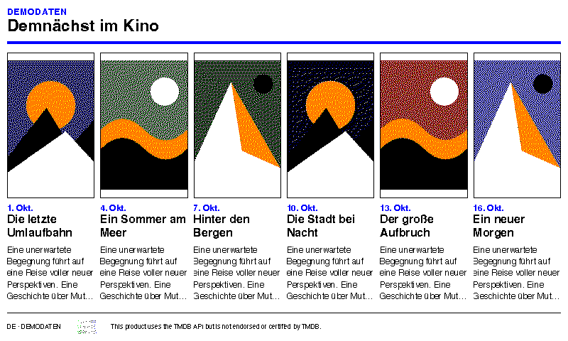 | 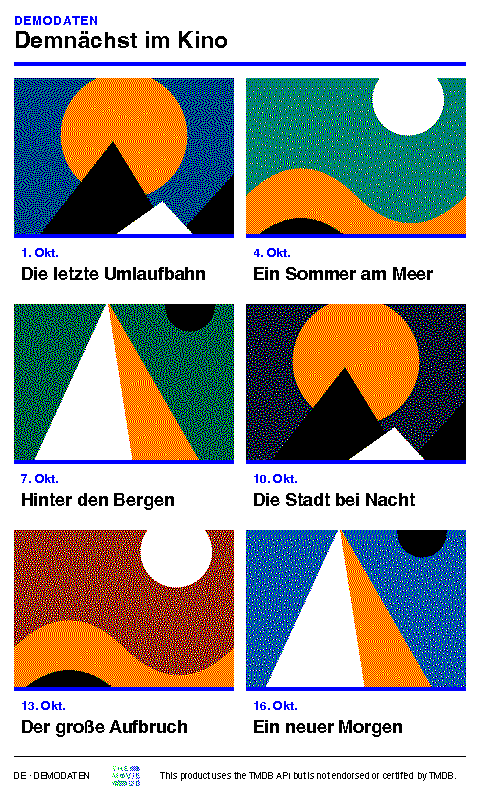 |
| Alternative Farbvariante | 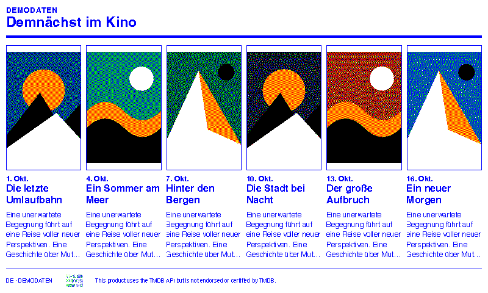 |  |

Große Formate: [default 1600x1200](../applications/upcoming-movies/screenshots/upcoming-movies-default-1600x1200.png) · [default 1200x1600](../applications/upcoming-movies/screenshots/upcoming-movies-default-1200x1600.png) · [dark 1600x1200](../applications/upcoming-movies/screenshots/upcoming-movies-dark-1600x1200.png) · [dark 1200x1600](../applications/upcoming-movies/screenshots/upcoming-movies-dark-1200x1600.png)

## Kino: React-Prüfung

Die aktive Integration verwendet ausschließlich HTML, CSS und ES-Module. Der Browser lädt `paperless.iife.js`, `assets/render.js` und `assets/defaults.js`. Quellcode und Browserlaufzeit wurden auf React/ReactDOM, JSX-Runtime und Next.js geprüft; keine dieser Bibliotheken wird verwendet.
