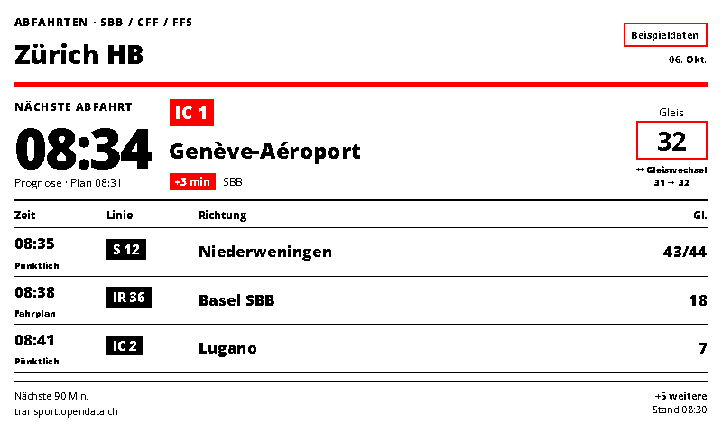
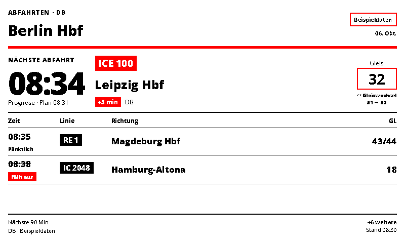
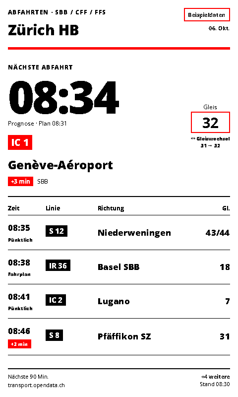
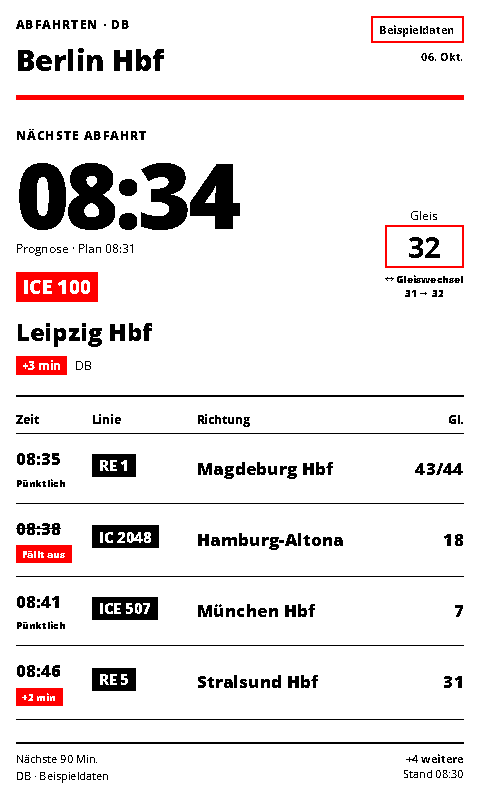
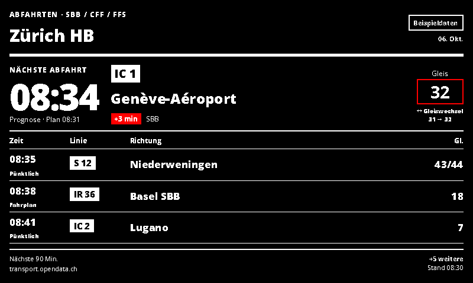
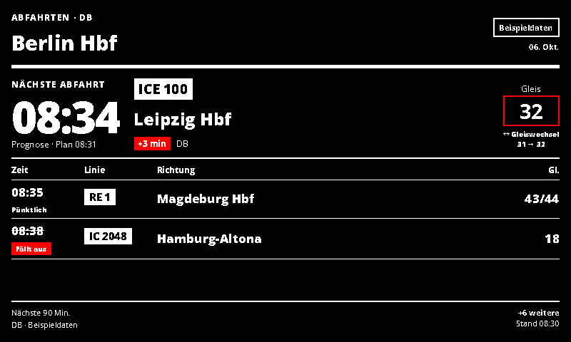

# Shared DB / SBB departure boards

Both integrations use the same layout, typography, status labels and fitting
from the canonical openintegration library. Provider settings and data sources
remain separate. Red-light, blue-dark and dark are captured at 800×480, 480×800,
1600×1200 and 1200×1600, as raw browser images and processed Spectra 6 images.
All images in this folder are explicitly labelled fictional examples.

| SBB | DB |
| --- | --- |
|  |  |
|  |  |
|  |  |

The correction gives clipped text a 1.4 line height and additional ink padding.
Horizontal ellipsis still limits long names. Whole rows are hidden and counted
when space runs out, and restored on resize. The portrait columns accommodate
train numbers and combined platform labels such as `43/44` on one line.

```sh
node scripts/check-departure-layouts.mjs
node scripts/render-departure-screenshots.mjs
```

The regression check compares clipped and unclipped screenshots of the same
text. For `Niederweningen`, they must be pixel-identical in the station header,
main destination and departure list. It also checks 180 language/theme/size
combinations, escaped text, platform-change settings, empty and error screens.
